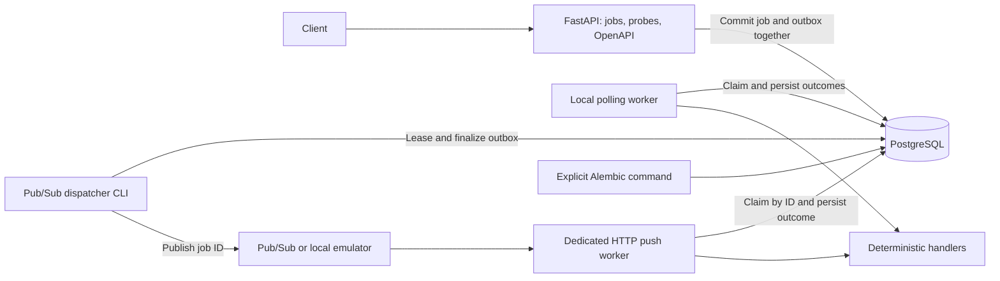

# Distributed Cloud Task Scheduler

A portfolio backend project focused on explainable distributed job execution,
PostgreSQL transactions, delivery semantics and failure recovery. Development is
local-first and follows validated milestones. The local foundation contains a
FastAPI API, persisted jobs with optional submission idempotency, atomic local execution,
durable dispatch obligations,
PostgreSQL connectivity, explicit Alembic migrations, container setup and a
Pub/Sub publisher/push worker validated with the local emulator. Cloud deployment
and automatic execution retries are planned work; see the
[living plan](docs/PLAN.md).

## Current architecture



One application package owns typed settings and lifespan-managed SQLAlchemy
resources. Each operation gets its own session. Liveness is independent of the
database; readiness executes `SELECT 1`. Migrations are an explicit command,
separate from starting API replicas. The baseline establishes a migration chain
without adding placeholder domain tables; revisions 0002 and 0003 add jobs and
execution ownership/outcomes. Revision 0004 adds the transactional dispatch outbox
and backfills existing PENDING, QUEUED and RUNNING jobs. Direct database polling
and Pub/Sub push both use the same execution ownership rules. The push worker
runs separately from the submission API so Cloud Run service IAM can protect it.
Revision 0005 adds nullable submission keys/fingerprints and their database constraints;
existing jobs retain their identities and execution/dispatch state.

The target cloud stack is GCP Pub/Sub, Cloud Run and Cloud SQL, added after local
execution and concurrency have been proved. See the
[specification](docs/PROJECT_SPEC.md) for the target design and reliability goals.

## Local setup

Use Python 3.12+ and Docker Desktop with Linux containers, or Docker Engine with
Compose on Linux. No GCP account is needed. Create and activate a virtual environment:

```powershell
python -m venv .venv
.venv\Scripts\Activate.ps1
python -m pip install -e ".[dev]"
Copy-Item .env.example .env
```

On Linux/macOS, activate with `source .venv/bin/activate` and copy the example
with `cp .env.example .env`. Activation is optional if commands use the virtual
environment's Python executable directly. `.env` is ignored by Git and excluded
from the Docker build context.

The example credentials are dummy local values. Choose your own and keep
`POSTGRES_PASSWORD`, `DATABASE_URL`, `COMPOSE_DATABASE_URL` and `TEST_DATABASE_URL`
consistent. Environment variables override `.env`. URL-encode special characters
in passwords. Changing initialization credentials after a PostgreSQL volume has
been created does not change the existing database's credentials.

Start PostgreSQL and build the API image, then migrate explicitly:

```text
docker compose up -d --wait db
docker compose build api
docker compose run --rm api python -m alembic upgrade head
docker compose up -d api
```

Open [Swagger UI](http://127.0.0.1:8000/docs). Probe examples:

```text
curl http://127.0.0.1:8000/health
curl http://127.0.0.1:8000/ready
```

In Windows PowerShell, use `curl.exe` or `Invoke-RestMethod`. To run the API on
the host instead, keep PostgreSQL running, stop the Compose API to free port
8000, and use:

```text
docker compose stop api
python -m alembic upgrade head
python -m distributed_cloud_scheduler
```

The module entry point accepts `--host` and `--port` and selects a
psycopg-compatible asyncio loop on Windows. Use this entry point for host startup.
Database URLs differ inside Compose (`db:5432`) and on the host
(`127.0.0.1:5433`); the environment example supplies both.

`docker compose down` stops/removes the project containers and network while
preserving database data. This is a development environment; production hardening
and deployment follow later milestones.

## API and configuration

| Endpoint | Behavior |
| --- | --- |
| `POST /jobs` | `201` with a new job/outbox; matching `Idempotency-Key` replay returns current job with `200`, different content returns `409` |
| `GET /jobs/{job_id}` | Persisted job or `404`; invalid UUID returns `422` |
| `GET /jobs` | `{items, limit, offset}`; newest first with a UUID tie-breaker |
| `GET /health` | `200 {"status":"ok"}` without querying dependencies |
| `GET /ready` | `200 {"status":"ready"}` after a query; otherwise sanitized `503 {"status":"not_ready"}` |
| `GET /docs` | Swagger/OpenAPI interface |

Example submission and inspection in PowerShell:

```powershell
$job = Invoke-RestMethod -Uri http://127.0.0.1:8000/jobs -Method Post -ContentType 'application/json' -Body '{"type":"calculation","payload":{"numbers":[1,2,3]},"max_attempts":3}'
Invoke-RestMethod -Uri "http://127.0.0.1:8000/jobs/$($job.id)"
Invoke-RestMethod -Uri 'http://127.0.0.1:8000/jobs?limit=20&offset=0'
```

Run the worker on the host or using the existing image:

```text
python -m distributed_cloud_scheduler.worker --once
docker compose run --rm api python -m distributed_cloud_scheduler.worker --once
```

`--once` claims at most one PENDING or QUEUED job, regardless of configured concurrency.
Without it the worker polls continuously with `WORKER_CONCURRENCY` independent
execution slots (default 1, maximum 20).
Inspect the job again to see `SUCCEEDED` with `result_metadata`, or `FAILED` with
classified `error_info`. Handler payload validation happens during execution;
the submission API accepts a generic validated JSON object.

| Task type | Payload and result |
| --- | --- |
| `calculation` | `{"numbers":[1,2,3]}` -> `{"sum":6}`; at most 1,000 finite numbers, each within ±1 billion |
| `sleep` | `{"seconds":0.1}` -> `{"slept_seconds":0.1}`; 0 through 10 seconds |
| `controlled_failure` | `{"fail_until_attempt":1}` fails on attempt 1; 0 through 20; use 0 for immediate success |

Unknown types and invalid handler payloads become permanent classified failures.
Controlled failures and timeouts are classified retryable, but automatic retries
are not yet implemented. Every task error currently ends the job as FAILED.

Task identifiers start with a lowercase ASCII letter, followed by lowercase
letters, digits or underscores, up to 64 characters. Payloads must be JSON objects
and fit within 64 KiB of compact UTF-8 JSON; non-finite numbers, NUL characters
and invalid Unicode are rejected. `max_attempts` is an integer from 1 to 20
(default 3). Extra submission fields are rejected. Stored timestamps are returned
in UTC. Without an `Idempotency-Key`, repeated requests create separate jobs.

List `limit` is 1 through 100 (default 20); `offset` is 0 through 10,000 (default
0). Ordering is deterministic within a database snapshot; offset pages can shift
under concurrent inserts. This API does not promise an across-request snapshot.

Readiness checks connectivity, not schema revision. Run migrations before using
job endpoints. The configured readiness timeout bounds the probe;
driver cancellation/connection cleanup can add latency during network failures.

| Runtime setting | Meaning |
| --- | --- |
| `DATABASE_URL` | Required `postgresql+psycopg://...` URL with host and database; no default credentials |
| `READINESS_TIMEOUT_SECONDS` | Finite value greater than 0 and at most 30; default 2 |
| `DATABASE_CONNECT_TIMEOUT_SECONDS` | Integer 1 through 30; default 3 |
| `WORKER_TASK_TIMEOUT_SECONDS` | Finite value greater than 0 and at most 30; default 15 |
| `WORKER_LEASE_SECONDS` | Integer 1 through 300, greater than task timeout plus 5; default 60 |
| `WORKER_POLL_INTERVAL_SECONDS` | Finite value greater than 0 and at most 10; default 0.5 |
| `WORKER_CONCURRENCY` | Integer 1 through 20; default 1 |
| `WORKER_SHUTDOWN_TIMEOUT_SECONDS` | Finite value greater than 0 and at most 60; default 20 |
| `DISPATCH_PUBLISH_TIMEOUT_SECONDS` | Finite value greater than 0 and at most 30; default 10 |
| `DISPATCH_LEASE_SECONDS` | Integer 1 through 300, greater than publish timeout plus 5; default 30 |
| `DISPATCH_RETRY_BASE_SECONDS` | Finite value greater than 0 and at most 30; default 1 |
| `DISPATCH_RETRY_MAX_SECONDS` | Finite value greater than 0 and at most 300, at least the retry base; default 60 |
| `DISPATCH_POLL_INTERVAL_SECONDS` | Finite value greater than 0 and at most 10; default 0.5 |
| `DISPATCH_SHUTDOWN_TIMEOUT_SECONDS` | Finite value greater than 0 and at most 60; default 20 |
| `PUBSUB_TOPIC` | Full `projects/.../topics/...` name; required only by the dispatcher |
| `PUBSUB_SUBSCRIPTION` | Full `projects/.../subscriptions/...` name; required only by the push worker |
| `PUBSUB_EMULATOR_HOST` | Optional `host:port` for local insecure emulator RPC; omit for GCP ADC/TLS |
| `PUSH_REQUEST_TIMEOUT_SECONDS` | Total push request work budget, finite greater than 0 and at most 60; default 45; must exceed task timeout by 5 |

`COMPOSE_DATABASE_URL`, `POSTGRES_DB`, `POSTGRES_USER`, `POSTGRES_PASSWORD`,
`POSTGRES_PORT` and `API_PORT` configure local Compose. PostgreSQL and API ports
bind to loopback by default. Secrets are redacted from settings representations
and validation error strings; readiness responses never echo database errors.
Host commands read runtime settings from `.env`. Compose passes the internal
database URL to containers; pass other runtime overrides explicitly, for example
`docker compose run --rm -e WORKER_CONCURRENCY=3 api python -m distributed_cloud_scheduler.worker`.

## Submission idempotency

`POST /jobs` accepts one optional `Idempotency-Key` header: 1-128 ASCII letters,
digits or `._:-`. Keys are exact, case-sensitive and global within the database.
Whitespace, empty values, non-ASCII characters and repeated header fields return
422; the service does not trim or merge keys. Generate a unique key for each
logical submission, then reuse it when retrying that submission.

A new key returns 201 and atomically commits one job and one outbox obligation.
Matching replay returns 200 with the same job's current state, including any
completed result or failure. Reusing a key for different type, payload or
`max_attempts` returns sanitized 409. Concurrent API replicas coordinate through
PostgreSQL uniqueness; replay creates no new job/outbox or execution attempt.
Rolled-back submissions, including cancellation during an unfinished insert,
leave the key reusable. If a response is lost or commit acceptance is ambiguous,
retry the same key to resolve whether the job committed.

Content matching uses SHA-256 of the validated request, including defaults, with
sorted nested object keys and compact UTF-8 JSON. Object order, whitespace,
Unicode escaping and omitted versus explicit `max_attempts: 3` match. Array order
and exact strings matter; Unicode is not normalized. Parsed numeric representation
also matters: integer `1` differs from float `1.0`, and `-0.0` differs from `0.0`.
Float spellings that parse identically match. Large integers retain their precision.
The original fingerprint is stored independently of later JSONB/execution changes.

Keys remain bound while their jobs exist; there is no expiry or deletion/retention
feature yet. Keys and fingerprints are internal and are absent from job responses.
Global keys provide no access control. Submission identity and database ownership
do not establish exactly-once external side effects; current handlers are deterministic.

Example retry using the same generated key:

```powershell
$headers = @{ 'Idempotency-Key' = [guid]::NewGuid().ToString() }
$body = '{"type":"calculation","payload":{"numbers":[1,2,3]}}'
Invoke-RestMethod -Uri http://127.0.0.1:8000/jobs -Method Post -Headers $headers -ContentType 'application/json' -Body $body
Invoke-RestMethod -Uri http://127.0.0.1:8000/jobs -Method Post -Headers $headers -ContentType 'application/json' -Body $body
```

Swagger exposes the optional header and the 200/201/409 responses. See
[D011](docs/DECISIONS.md) for the transaction and normalization choices.

## Local execution semantics

Workers select PENDING or QUEUED rows in short `FOR UPDATE SKIP LOCKED` transactions,
commit a RUNNING claim with a token/lease and increment the attempt count, then
execute outside the transaction. Completion locks the row and rechecks the token
and current database time, preventing a stale owner from committing an outcome.
Claim tokens stay internal; the API returns outcome metadata and UTC timestamps.

Polling workers recover expired owners to FAILED with `worker_lost`. Recovery
requires a worker to poll; it does not re-execute failed jobs yet. Worker loops
share an engine, with independent operation sessions. The concurrency limit is
per process; multiple processes coordinate through database claims. Size process
counts and connection pools together for deployment.

SIGINT/SIGTERM requests stop new admission and drain in-flight work for the
configured shutdown grace period. Claims already being committed may be admitted
as in-flight work. Remaining tasks are cancelled after the grace period and attempt
to record a fenced `cancelled` failure; unavailable cleanup leaves lease recovery
to a later poll. A second signal cancels immediately. Driver cancellation and
cleanup can add latency beyond the drain period. Connection/pool failures pause
polling and retry; unexpected worker-loop failures propagate after cleanup.

Current task deadlines fit inside leases with a safety margin, so periodic renewal
is deferred. Database ownership does not establish exactly-once external side
effects; current handlers have no external side effects.

## Durable dispatch boundary

Job creation commits both the job and a READY `dispatch_outbox` row in one
transaction. If either insert fails, neither persists. `dispatch_once` leases one
due obligation, calls an async `Publisher.publish(job_id)` outside the transaction,
then records PUBLISHED using the current token and an unexpired lease. Transport
acceptance is separate from job success. The job becomes QUEUED only if still
PENDING; publication never replaces RUNNING or a terminal execution state.

Failed publication keeps the obligation READY with a sanitized error code and
exponential backoff capped by `DISPATCH_RETRY_MAX_SECONDS`. Interrupted publishers
leave a PUBLISHING lease that can be reclaimed after expiry. A crash after transport
acceptance but before the database marker can publish the same ID again. Both
ID-specific delivery and polling use the same database claim rules, so duplicate
deliveries cannot claim an already RUNNING or terminal job or increase its attempts.
Outbox rows for jobs already completed locally are explicitly SKIPPED.

`LocalQueue` is a bounded, in-process test adapter with backpressure. Its messages
do not survive process exit, and it is not a broker shared by CLI processes.
The Pub/Sub dispatcher runs serially, leasing one obligation per publication:

```text
python -m distributed_cloud_scheduler.dispatcher --once
python -m distributed_cloud_scheduler.dispatcher
```

Set `PUBSUB_TOPIC` first. `--once` attempts at most one due obligation, and a failed
publish remains READY with backoff. An exit code of zero does not mean publication
succeeded; inspect the outbox for accepted versus deferred publication. Continuous
mode polls and retries database connectivity failures. Signals stop new admission,
drain the current publication, then cancel after the dispatch shutdown budget.
The async Google SDK publishes exactly one canonical UUID as ASCII bytes with a
bounded RPC and no implicit SDK retry; the outbox owns durable publication retries.
Cancellation/timeout can leave ambiguous broker acceptance and later replay.

The durable outbox relies on a dispatcher being invoked; it cannot publish by
itself. Publication retries do not re-execute FAILED jobs. Local delivery and
publication failure/replay remain covered in [delivery tests](tests/integration/test_delivery.py)
and [dispatcher tests](tests/integration/test_dispatcher.py). Execution retry and
outbox retention policy follow later milestones.

## Pub/Sub push worker

Run the dedicated worker after setting `PUBSUB_SUBSCRIPTION`:

```text
python -m distributed_cloud_scheduler.push --host 127.0.0.1 --port 8001
```

Its OpenAPI, liveness and database readiness endpoints are `/docs`, `/health` and
`/ready`. The submission API has no push endpoint. `POST /pubsub/push` accepts the
default wrapped Pub/Sub JSON envelope: matching `subscription`, nonempty
`message.messageId` (or `message_id`), and `message.data` containing strict base64 of a canonical
36-byte UUID. The whole body is limited to 8 KiB. Transport metadata is accepted;
it cannot supply task data or execution attempts. Unwrapped delivery is unsupported.

| Delivery condition | HTTP result |
| --- | --- |
| Committed success or classified failure; terminal duplicate | 204 ACK |
| Expired target owner recovered to FAILED/worker_lost | 204 ACK |
| Active ownership, row contention, full capacity or rejected completion | 503, redeliver |
| Database failure or total request timeout | 503, redeliver |
| Unknown job ID | 404, redeliver |
| Invalid envelope/subscription/data; oversized body | 400 / 413, redeliver |

Pub/Sub retries all these non-success responses. Unknown or malformed messages
may therefore repeat indefinitely before a future dead-letter policy is configured.
A FAILED job is currently terminal even if its error is classified retryable;
broker delivery count does not consume or control execution attempts.

The worker reserves at most `WORKER_CONCURRENCY` request slots per process and
executes within the HTTP request. It uses the same handler deadline, database
lease and fenced completion as polling. A RUNNING duplicate is not acknowledged
while another owner may still fail. A redelivery recovers only its target's expired
ownership. No background execution is required after a response.

The default task/request deadlines are 15/45 seconds. Future deployment must set
both the push subscription acknowledgement deadline and Cloud Run request timeout
to at least 60 seconds, allowing time for cancellation cleanup. Driver cleanup can
add latency. Size replica concurrency and database connection pools together.

Local HTTP has no sender authentication. Subscription matching validates routing,
not identity. Deploy this worker as a private Cloud Run service with Pub/Sub OIDC
and `roles/run.invoker`; Cloud Run validates the token and audience. Service IAM,
cloud delivery and infrastructure have not been validated here. See
[D010](docs/DECISIONS.md) and Google's [authenticated push documentation](https://docs.cloud.google.com/pubsub/docs/authenticate-push-subscriptions).

## Local Pub/Sub emulator verification

The optional Compose file adds Google's Pub/Sub emulator, bound to loopback port
8681. It needs no GCP account or host gcloud installation. With the dedicated
`TEST_DATABASE_URL` configured as described below, run on Windows:

```powershell
docker compose -f compose.yaml -f compose.pubsub.yaml up -d --wait db pubsub
$env:PUBSUB_EMULATOR_HOST = '127.0.0.1:8681'
python scripts/pubsub_smoke.py --push-host host.docker.internal
```

The smoke creates a random schema, topic and push subscription, starts live API
and push worker processes on free ports, and exercises the real dispatcher CLI/Google SDK.
It verifies keyed create/replay/conflict and current-state replay after execution,
nested object/default matching, independent no-key submissions, persisted results,
success/failure duplicate ACKs, malformed/unknown/oversized
requests, and durable publication recovery after a broker connection failure.
It removes its resources and fails when prerequisites or checks fail.
`--push-host` must be reachable from the emulator; Docker Desktop uses
`host.docker.internal` to reach the host worker. The default `127.0.0.1` suits
an emulator running directly on the same host.

The same smoke also runs inside the Linux runtime image. Build the image, then
use the example below with credentials matching your local database:

```text
docker compose build api
docker compose -f compose.yaml -f compose.pubsub.yaml run --rm --no-deps --name pubsub-smoke-runner -e TEST_DATABASE_URL=postgresql+psycopg://scheduler:example_local_password@db:5432/scheduler_test -e PUBSUB_EMULATOR_HOST=pubsub:8085 -v ./scripts:/app/scripts:ro api python scripts/pubsub_smoke.py --push-host pubsub-smoke-runner
```

The container's `TEST_DATABASE_URL` uses `db:5432`, while host tests use
`127.0.0.1:5433`. These are dummy example credentials. The script refuses the
application database and requires a separate name ending in `_test`.
To stop just the optional broker, use
`docker compose -f compose.yaml -f compose.pubsub.yaml stop pubsub`.
Emulator data is temporary and it does not validate IAM or production delivery guarantees.

## Verification

Create the dedicated integration database once, with the example database user:

```text
docker compose exec -T db createdb -U scheduler scheduler_test
python scripts/check.py
python -m alembic check
```

Adapt the user/database names if you changed the example. `TEST_DATABASE_URL`
comes from your environment or `.env` and must point to a separate database whose
name ends in `_test`. Each integration test creates and removes only its own
random schema. Tests never downgrade the application's database and never use
SQLite as a substitute for PostgreSQL.

The standard command runs `ruff check .`, strict `mypy src`, and `pytest` with the
active interpreter. The `src` layout requires installing the package. Unit tests
cover settings, error sanitization, liveness, readiness cancellation and resource
cleanup and job validation. Database tests cover real async connections/readiness,
job API persistence/ordering, database constraints, competing claims, stale-token
and lock-wait expiry races, cancellation, concurrency limits, graceful draining,
independent process claims/crashes and handler isolation, atomic job/outbox commits,
publication failure/backoff/replay, duplicate ID delivery, push envelope validation,
HTTP ACKs, push capacity/deadlines/cancellation, targeted lease recovery, and an Alembic
upgrade/downgrade/re-upgrade round trip with active-job backfill. Integration tests
explicitly skip if no test URL is configured; skips do not validate the database
milestone. `alembic check` checks ORM/schema drift against the migrated application
database without changing its schema.

Submission tests cover matching/conflicting requests across independent API engines,
actual uniqueness lock waits followed by commit/rollback/cancellation, atomic
job/outbox rollback, and unchanged current-state replay after execution. Migration
tests preserve existing rows across the nullable idempotency metadata change.

## Engineering documents

- [Project specification](docs/PROJECT_SPEC.md): purpose, boundaries and target design.
- [Living development plan](docs/PLAN.md): current architecture, validation and next work.
- [Architecture decisions](docs/DECISIONS.md): significant choices and trade-offs.
- [Development workflow](AGENTS.md): persistent rules for future contributions.

Key decisions: PostgreSQL owns state and dispatch obligations; migrations run
explicitly; async sessions belong to individual operations; Pub/Sub push remains
provisional until delivery and recovery semantics are validated. No frontend,
account system or Kubernetes is part of the initial scope.
