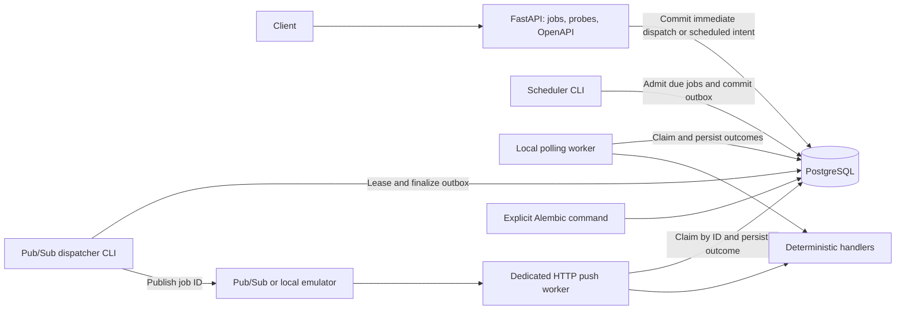

# Distributed Cloud Task Scheduler

A portfolio backend project focused on explainable distributed job execution,
PostgreSQL transactions, delivery semantics and failure recovery. Development is
local-first and follows validated milestones. The local foundation contains a
FastAPI API, persisted jobs with optional submission idempotency, atomic execution,
scheduled jobs with a separate scheduler, bounded priority preference with aging,
bounded execution retries, dead-letter
context, manual recovery, attempt history
and durable dispatch obligations,
PostgreSQL connectivity, explicit Alembic migrations, container setup and a
Pub/Sub publisher/push worker validated with the local emulator. Cloud deployment
is planned work; see the
[living plan](docs/PLAN.md).

## Current architecture



One application package owns typed settings and lifespan-managed SQLAlchemy
resources. Each operation gets its own session. Liveness is independent of the
database; readiness executes `SELECT 1`. Migrations are an explicit command,
separate from starting API replicas. The baseline establishes a migration chain
without adding placeholder domain tables; revisions 0002 and 0003 add jobs and
execution ownership/outcomes. Revision 0004 adds the transactional dispatch outbox
and backfills existing PENDING, QUEUED and RUNNING jobs. Direct database polling
and Pub/Sub push both use the same execution ownership rules. The push worker
runs separately from the submission API so Cloud Run service IAM can protect it.
Revision 0005 adds nullable submission keys/fingerprints and their database constraints;
existing jobs retain their identities and execution/dispatch state.
Revision 0006 adds durable retry timing and execution attempt history. Existing
terminal jobs remain terminal; only known active ownership is backfilled.
Revision 0007 adds recovery generations and final dead-letter context, retaining
all existing records as generation zero without reclassifying historical failures.
Revision 0008 adds original schedule timestamps, SCHEDULED admission intent and
a partial due index. Legacy submissions keep NULL dates and their original hashes.
Revision 0009 adds immutable priority and internal readiness timestamps for bounded
preference with aging. Legacy priority is zero and retains every original hash.

The target cloud stack is GCP Pub/Sub, Cloud Run and Cloud SQL, added after local
execution and concurrency have been proved. See the
[specification](docs/PROJECT_SPEC.md) for the target design and reliability goals.

## Local setup

Use Python 3.12+ and Docker Desktop with Linux containers, or Docker Engine with
Compose on Linux. No GCP account is needed. Create and activate a virtual environment:

```powershell
python -m venv .venv
.venv\Scripts\Activate.ps1
python -m pip install -e ".[dev]"
Copy-Item .env.example .env
```

On Linux/macOS, activate with `source .venv/bin/activate` and copy the example
with `cp .env.example .env`. Activation is optional if commands use the virtual
environment's Python executable directly. `.env` is ignored by Git and excluded
from the Docker build context.

The example credentials are dummy local values. Choose your own and keep
`POSTGRES_PASSWORD`, `DATABASE_URL`, `COMPOSE_DATABASE_URL` and `TEST_DATABASE_URL`
consistent. Environment variables override `.env`. URL-encode special characters
in passwords. Changing initialization credentials after a PostgreSQL volume has
been created does not change the existing database's credentials.

Start PostgreSQL and build the API image, then migrate explicitly:

```text
docker compose up -d --wait db
docker compose build api
docker compose run --rm api python -m alembic upgrade head
docker compose up -d api
```

Open [Swagger UI](http://127.0.0.1:8000/docs). Probe examples:

```text
curl http://127.0.0.1:8000/health
curl http://127.0.0.1:8000/ready
```

In Windows PowerShell, use `curl.exe` or `Invoke-RestMethod`. To run the API on
the host instead, keep PostgreSQL running, stop the Compose API to free port
8000, and use:

```text
docker compose stop api
python -m alembic upgrade head
python -m distributed_cloud_scheduler
```

The module entry point accepts `--host` and `--port` and selects a
psycopg-compatible asyncio loop on Windows. Use this entry point for host startup.
Database URLs differ inside Compose (`db:5432`) and on the host
(`127.0.0.1:5433`); the environment example supplies both.

`docker compose down` stops/removes the project containers and network while
preserving database data. This is a development environment; production hardening
and deployment follow later milestones.

## API and configuration

| Endpoint | Behavior |
| --- | --- |
| `POST /jobs` | `201` persists immediate job/outbox or scheduled intent; matching `Idempotency-Key` replay returns current job with `200`, different content returns `409` |
| `GET /jobs/{job_id}` | Persisted job or `404`; invalid UUID returns `422` |
| `GET /jobs/{job_id}/attempts` | Paginated generation/attempt history; optional `generation` filter, default limit 20 |
| `POST /jobs/{job_id}/retry` | `202` reopens FAILED/DEAD_LETTERED with required `expected_generation`; stale/ineligible retry returns `409` |
| `GET /jobs` | `{items, limit, offset}`; newest first with a UUID tie-breaker |
| `GET /health` | `200 {"status":"ok"}` without querying dependencies |
| `GET /ready` | `200 {"status":"ready"}` after a query; otherwise sanitized `503 {"status":"not_ready"}` |
| `GET /metrics` | Process-local Prometheus scrape data on the API and push worker |
| `GET /docs` | Swagger/OpenAPI interface |

Example submission and inspection in PowerShell:

```powershell
$job = Invoke-RestMethod -Uri http://127.0.0.1:8000/jobs -Method Post -ContentType 'application/json' -Body '{"type":"calculation","payload":{"numbers":[1,2,3]},"max_attempts":3}'
Invoke-RestMethod -Uri "http://127.0.0.1:8000/jobs/$($job.id)"
Invoke-RestMethod -Uri 'http://127.0.0.1:8000/jobs?limit=20&offset=0'
```

Run the worker on the host or using the existing image:

```text
python -m distributed_cloud_scheduler.worker --once
docker compose run --rm api python -m distributed_cloud_scheduler.worker --once
```

`--once` claims at most one PENDING, QUEUED or due RETRY_WAIT job, regardless of concurrency.
Without it the worker polls continuously with `WORKER_CONCURRENCY` independent
execution slots (default 1, maximum 20).
Inspect the job again to see `SUCCEEDED` with `result_metadata`, or RETRY_WAIT/FAILED/DEAD_LETTERED
with classified `error_info`. Handler payload validation happens during execution;
the submission API accepts a generic validated JSON object.

| Task type | Payload and result |
| --- | --- |
| `calculation` | `{"numbers":[1,2,3]}` -> `{"sum":6}`; at most 1,000 finite numbers, each within ±1 billion |
| `sleep` | `{"seconds":0.1}` -> `{"slept_seconds":0.1}`; 0 through 10 seconds |
| `controlled_failure` | `{"fail_until_attempt":1}` fails on attempt 1; 0 through 20; use 0 for immediate success |

Unknown types and invalid handler payloads become permanent classified failures.
Controlled failures and timeouts schedule automatic retries while budget remains;
permanent failures finish as FAILED and exhausted transient failures as DEAD_LETTERED.
`--once` processes one attempt;
run continuously to execute a retry after its due time.

Task identifiers start with a lowercase ASCII letter, followed by lowercase
letters, digits or underscores, up to 64 characters. Payloads must be JSON objects
and fit within 64 KiB of compact UTF-8 JSON; non-finite numbers, NUL characters
and invalid Unicode are rejected. `max_attempts` is an integer from 1 to 20
(default 3). Extra submission fields are rejected. Stored timestamps are returned
in UTC. Without an `Idempotency-Key`, repeated requests create separate jobs.
Optional `scheduled_at` controls initial scheduler admission; see the scheduling
section below for its timestamp format and runtime requirement.
Optional `priority` is a strict integer 0 through 9 (default 0), exposed in job
reads. Higher values give eligible work a bounded preference; see the policy below.

List `limit` is 1 through 100 (default 20); `offset` is 0 through 10,000 (default
0). Ordering is deterministic within a database snapshot; offset pages can shift
under concurrent inserts. This API does not promise an across-request snapshot.

Readiness checks connectivity, not schema revision. Run migrations before using
job endpoints. The configured readiness timeout bounds the probe;
driver cancellation/connection cleanup can add latency during network failures.

| Runtime setting | Meaning |
| --- | --- |
| `DATABASE_URL` | Required `postgresql+psycopg://...` URL with host and database; no default credentials |
| `READINESS_TIMEOUT_SECONDS` | Finite value greater than 0 and at most 30; default 2 |
| `DATABASE_CONNECT_TIMEOUT_SECONDS` | Integer 1 through 30; default 3 |
| `WORKER_TASK_TIMEOUT_SECONDS` | Finite value greater than 0 and at most 30; default 15 |
| `WORKER_LEASE_SECONDS` | Integer 1 through 300, greater than task timeout plus 5; default 60 |
| `WORKER_POLL_INTERVAL_SECONDS` | Finite value greater than 0 and at most 10; default 0.5 |
| `WORKER_CONCURRENCY` | Integer 1 through 20; default 1 |
| `WORKER_SHUTDOWN_TIMEOUT_SECONDS` | Finite value greater than 0 and at most 60; default 20 |
| `DISPATCH_PUBLISH_TIMEOUT_SECONDS` | Finite value greater than 0 and at most 30; default 10 |
| `DISPATCH_LEASE_SECONDS` | Integer 1 through 300, greater than publish timeout plus 5; default 30 |
| `DISPATCH_RETRY_BASE_SECONDS` | Finite value greater than 0 and at most 30; default 1 |
| `DISPATCH_RETRY_MAX_SECONDS` | Finite value greater than 0 and at most 300, at least the retry base; default 60 |
| `DISPATCH_POLL_INTERVAL_SECONDS` | Finite value greater than 0 and at most 10; default 0.5 |
| `DISPATCH_SHUTDOWN_TIMEOUT_SECONDS` | Finite value greater than 0 and at most 60; default 20 |
| `SCHEDULER_BATCH_SIZE` | Integer 1 through 1,000; default 100; maximum jobs admitted per transaction |
| `SCHEDULER_POLL_INTERVAL_SECONDS` | Finite value greater than 0 and at most 10; default 0.5 |
| `SCHEDULER_SHUTDOWN_TIMEOUT_SECONDS` | Finite value greater than 0 and at most 60; default 20 |
| `PUBSUB_TOPIC` | Full `projects/.../topics/...` name; required only by the dispatcher |
| `PUBSUB_SUBSCRIPTION` | Full `projects/.../subscriptions/...` name; required only by the push worker |
| `PUBSUB_EMULATOR_HOST` | Optional `host:port` for local insecure emulator RPC; omit for GCP ADC/TLS |
| `PUSH_REQUEST_TIMEOUT_SECONDS` | Total push request work budget, finite greater than 0 and at most 60; default 45; must exceed task timeout by 5 |

`COMPOSE_DATABASE_URL`, `POSTGRES_DB`, `POSTGRES_USER`, `POSTGRES_PASSWORD`,
`POSTGRES_PORT` and `API_PORT` configure local Compose. PostgreSQL and API ports
bind to loopback by default. Secrets are redacted from settings representations
and validation error strings; readiness responses never echo database errors.
Host commands read runtime settings from `.env`. Compose passes the internal
database URL to containers; pass other runtime overrides explicitly, for example
`docker compose run --rm -e WORKER_CONCURRENCY=3 api python -m distributed_cloud_scheduler.worker`.

## Submission idempotency

`POST /jobs` accepts one optional `Idempotency-Key` header: 1-128 ASCII letters,
digits or `._:-`. Keys are exact, case-sensitive and global within the database.
Whitespace, empty values, non-ASCII characters and repeated header fields return
422; the service does not trim or merge keys. Generate a unique key for each
logical submission, then reuse it when retrying that submission.

A new key returns 201 and atomically commits one job with durable dispatch or
scheduled admission intent. Immediate submissions have one outbox obligation;
scheduled submissions gain that obligation during scheduler admission.
Matching replay returns 200 with the same job's current state, including any
completed result or failure. Reusing a key for different type, payload or
`max_attempts`, original `scheduled_at` or effective `priority` returns sanitized
409. Concurrent API replicas coordinate through
PostgreSQL uniqueness; replay creates no new job/outbox or execution attempt.
Rolled-back submissions, including cancellation during an unfinished insert,
leave the key reusable. If a response is lost or commit acceptance is ambiguous,
retry the same key to resolve whether the job committed.

Content matching uses SHA-256 of the validated request, including defaults, with
sorted nested object keys and compact UTF-8 JSON. Object order, whitespace,
Unicode escaping and omitted versus explicit `max_attempts: 3` match. Array order
and exact strings matter; Unicode is not normalized. Parsed numeric representation
also matters: integer `1` differs from float `1.0`, and `-0.0` differs from `0.0`.
Float spellings that parse identically match. Large integers retain their precision.
The original fingerprint is stored independently of later JSONB/execution changes.
NULL and omitted `scheduled_at` retain exactly the original immediate-submission
fingerprint. Non-NULL dates add a UTC ISO string with six fractional digits;
equivalent instants expressed with different offsets/fraction spellings match.
The original schedule remains part of submission identity after admission,
automatic retries and manual recovery.
Omitted and explicit `priority: 0` preserve every earlier immediate and scheduled
fingerprint. Nonzero priority contributes its integer value. Priority is immutable
across automatic retries and manual recovery; no priority-edit API is provided.

Keys remain bound while their jobs exist; there is no expiry or deletion/retention
feature yet. Keys and fingerprints are internal and are absent from job responses.
Global keys provide no access control. Submission identity and database ownership
do not establish exactly-once external side effects; current handlers are deterministic.

Example retry using the same generated key:

```powershell
$headers = @{ 'Idempotency-Key' = [guid]::NewGuid().ToString() }
$body = '{"type":"calculation","payload":{"numbers":[1,2,3]}}'
Invoke-RestMethod -Uri http://127.0.0.1:8000/jobs -Method Post -Headers $headers -ContentType 'application/json' -Body $body
Invoke-RestMethod -Uri http://127.0.0.1:8000/jobs -Method Post -Headers $headers -ContentType 'application/json' -Body $body
```

Swagger exposes the optional header and the 200/201/409 responses. See
[D011](docs/DECISIONS.md) for the transaction and normalization choices.

## Priority policy and aging

Submit `priority` from 0 to 9; larger values receive a five-second head start per
level, at most 45 seconds. For example:

```json
{"type":"calculation","payload":{"numbers":[1,2,3]},"priority":9}
```

Scheduler admission, local polling and outbox publication select due, unlocked
database candidates by eligibility time minus `priority * 5 seconds`, then
eligibility time and UUID. At equal eligibility, higher priority wins. A priority-0
candidate eligible for more than 45 seconds ranks ahead of a freshly eligible
priority-9 candidate. Equal ranks prefer earlier eligibility; UUID resolves remaining
ties. This aging policy needs no background score updates or shared counters.

Job eligibility begins at database creation time for immediate submissions, or
the later of creation and original scheduled time. Submitting a past date does
not invent waiting time. Admission and publication retain that age; automatic
retry starts a new waiting period at next_attempt_at, and manual recovery starts
one at current database time. Internal ready_at stores this episode boundary and
is absent from public reads/input. Dispatch ranks READY obligations by available_at
and reclaimable PUBLISHING obligations by lease expiry, joining original job priority.
Publication failure/backoff and expired lease reclamation start new dispatch
waiting periods. Job waiting age is independent of publication attempts.

Priority never bypasses a future schedule/retry, claim ownership or attempt limit.
Locked candidates may be skipped, and existing executions continue. A delivered
ID claims its specific eligible job, even if a higher-priority job is waiting.
Concurrent selectors, publication, broker delivery and worker capacity can change
execution order. This policy promises database selection preference; it supplies
no global execution order, preemption or finite wall-time completion bound.

With a progressing selector, available capacity and advancing database time,
continuously eligible unlocked work cannot be starved by fresh urgent arrivals
after the maximum head start. Older backlog, locks and outages may still delay it.
Priority is a preference parameter, not access control or resource isolation.

Migration 0009 preserves existing jobs, hashes, history and obligations, assigning
priority 0 and deriving readiness from known creation/schedule/retry/recovery
timestamps. Stop runtimes before migration. Downgrade locks all three tables and
refuses while any nonzero priority remains, even on completed jobs, protecting
original submission identity. See [D015](docs/DECISIONS.md) for the policy and indexes.

## Scheduled jobs and scheduler

Submit `scheduled_at` as RFC 3339 text with `T`, an explicit UTC `Z` or numeric
offset, seconds and at most six fractional digits. For example:

```powershell
$scheduledBody = @{ type = 'calculation'; payload = @{ numbers = @(1, 2, 3) }; scheduled_at = [datetimeoffset]::UtcNow.AddSeconds(30).ToString('yyyy-MM-ddTHH:mm:ss.ffffffZ') } | ConvertTo-Json
$scheduledJob = Invoke-RestMethod -Uri http://127.0.0.1:8000/jobs -Method Post -ContentType 'application/json' -Body $scheduledBody
```

Dates normalize to UTC. Naive/date-only timestamps, numeric epochs, invalid
calendar/offset values, leap seconds, excessive precision and UTC overflow return 422. Past
dates are allowed. Any non-NULL date starts SCHEDULED, including an already-due
date; NULL/omitted dates keep immediate PENDING submission behavior.

Run the separate scheduler on the host or with the existing image:

```text
python -m distributed_cloud_scheduler.scheduler --once
python -m distributed_cloud_scheduler.scheduler
docker compose run --rm api python -m distributed_cloud_scheduler.scheduler --once
```

`--once` admits one bounded batch and exits; it does not wait for future jobs.
Continuous mode drains due batches and polls when idle. The scheduler uses the
PostgreSQL clock, locks due SCHEDULED jobs in the priority/aging order above with
`FOR UPDATE SKIP LOCKED`, and commits PENDING plus one immediate outbox per job in
the same transaction. Skipped locked rows can be admitted on a later pass; this is
admission order among available rows, without a global execution-order guarantee.
Failed/cancelled transactions leave scheduled intent intact. Multiple schedulers
and restarts cannot double admit a job. Admission itself consumes no execution
attempt and performs no broker call.

Run a dispatcher and push worker, or a polling worker, after admission. SCHEDULED
jobs never execute, even if an old ID arrives after their due time. Push ACKs that
durable admission intent; scheduler commit establishes fresh dispatch, and rollback
keeps the intent for its next pass. Initial PENDING/QUEUED claims also check the
original database due time. Retry backoff continues to use next_attempt_at;
manual recovery retains scheduled_at but opens an immediate new generation.

Scheduler shutdown stops new batches, drains the current transaction within the
configured grace period and then cancels it. Database connection failures retry
in continuous mode; `--once` reports failure with a nonzero exit. Scheduling is
eventual: polling interval, locks, database outages, dispatch and worker capacity
can delay execution beyond the requested instant. No recurrence or schedule-edit
interface is provided. Cloud scheduler invocation/CPU policy remains milestone 15;
an idle Cloud Run service is not assumed to run this polling loop.

Migration 0008 preserves legacy jobs, keys and obligations. Stop runtimes before
migrating. Downgrade takes table locks before checking and refuses while any job
retains a non-NULL scheduled_at, even after completion, to protect original schedule
and fingerprint semantics. See [D014](docs/DECISIONS.md).

## Local execution semantics

Workers select PENDING, QUEUED or due RETRY_WAIT rows in short
`FOR UPDATE SKIP LOCKED` transactions, commit a RUNNING claim with a token/lease,
increment the attempt count and insert its history record, then execute outside
the transaction. Completion locks the job and rechecks its generation, token, attempt number
and current database time. It checks lease validity again after outcome/history/
outbox writes, rolling everything back if a lock wait outlived ownership.
Claim tokens stay internal; the API returns outcome metadata and UTC timestamps.

Polling workers recover expired owners as `worker_lost`, scheduling a retry if
budget remains. Recovery requires a worker poll or delivery of that ID. Worker loops
share an engine, with independent operation sessions. The concurrency limit is
per process; multiple processes coordinate through database claims. Size process
counts and connection pools together for deployment.

SIGINT/SIGTERM requests stop new admission and drain in-flight work for the
configured shutdown grace period. Claims already being committed may be admitted
as in-flight work. Remaining tasks are cancelled after the grace period and attempt
to record a fenced `cancelled` failure; unavailable cleanup leaves lease recovery
to a later poll. A second signal cancels immediately. Driver cancellation and
cleanup can add latency beyond the drain period. Connection/pool failures pause
polling and retry; unexpected worker-loop failures propagate after cleanup.

Current task deadlines fit inside leases with a safety margin, so periodic renewal
is deferred. Database ownership does not establish exactly-once external side
effects; current handlers have no external side effects.

## Execution retries and history

PostgreSQL controls execution attempts. The default `max_attempts` is 3, including
the initial attempt, with a maximum of 20. Broker deliveries and publication
attempts do not consume this budget. Controlled failures, handler timeouts,
unexpected internal errors, cancellation and worker loss are retryable. Invalid
handler payloads and unknown task types are permanent. Permanent failures become
FAILED; retryable failures at the limit become DEAD_LETTERED with
`dead_letter_reason: "attempts_exhausted"`, a UTC `dead_lettered_at` and final
`error_info`. These states remain terminal until explicitly reopened.

A retryable failure with budget remaining atomically finalizes its attempt,
changes the job to RETRY_WAIT, persists `next_attempt_at` and inserts a new outbox
obligation available at that same time. `error_info` describes the latest failed
attempt. `finished_at` is that attempt's finish time, even while waiting; claiming
the next attempt clears both fields and `next_attempt_at`. Every attempt retains
its own outcome and chosen next retry time in history.

Backoff uses capped exponential equal jitter. After attempt n, the cap is
`min(EXECUTION_RETRY_BASE_SECONDS * 2^(n-1), EXECUTION_RETRY_MAX_SECONDS)` and the
delay is between half the cap and the cap. Defaults are 1/60 seconds; both settings
accept 0.001 through 300 seconds and maximum must be at least base. The due time
comes from the database clock and is chosen once. Restart, replay and early old
messages cannot move it or execute early. Publication leaves RETRY_WAIT intact;
only a due execution claim removes it.

Run the dispatcher for Pub/Sub retries to progress. Polling workers can claim
due retries directly; their later unused outbox obligations are skipped after
the job finishes. Push acknowledges committed retry intent because the outbox
retains the next dispatch. A lost response can cause another delivery, which
shares the same due gating and ownership rules.

`GET /jobs/{job_id}/attempts` returns an ordered JSON list with generation, attempt number,
status, start/finish times, outcome metadata and retry time, without claim tokens
or task payloads. Sort order is generation then attempt number. `limit` is 1..100
(default 20), `offset` is 0..10000 (default 0), and optional `generation` selects
one nonnegative generation. No attempts returns `[]`; an unknown job returns 404. History is
complete for claims admitted after migration 0006. Earlier completed history is
unavailable, and only known active RUNNING ownership is backfilled. Upgrading
does not revive existing FAILED jobs. Coordinate runtime upgrades because older
workers cannot interpret RETRY_WAIT. Downgrading 0006 stops waiting retries as
FAILED and removes retry timing/history, while retaining other job data and all
outbox records. See [D012](docs/DECISIONS.md) for retry authority and acknowledgement.

## Dead letters and manual recovery

Inspect the job's final error and attempt history before requesting recovery.
`POST /jobs/{job_id}/retry` requires the current `generation`, initially zero:

```powershell
$failed = Invoke-RestMethod -Uri "http://127.0.0.1:8000/jobs/$($job.id)"
$retryBody = @{ expected_generation = $failed.generation } | ConvertTo-Json
Invoke-RestMethod -Uri "http://127.0.0.1:8000/jobs/$($job.id)/retry" -Method Post -ContentType 'application/json' -Body $retryBody
Invoke-RestMethod -Uri "http://127.0.0.1:8000/jobs/$($job.id)/attempts?limit=20&offset=0"
```

Only FAILED and DEAD_LETTERED are eligible. A successful command returns 202 and
atomically increments generation, resets the current attempt budget/outcome and
commits immediate durable dispatch. Run a dispatcher or polling worker to execute
it. Earlier history and outbox records remain; task data, max_attempts, creation
time and submission identity remain bound to the same job. Matching submission
key replay observes its current generation without creating another obligation.
Each generation has its own 1..20 attempt budget. `controlled_failure` therefore
counts from attempt 1 again and may exhaust again with the same payload.

Concurrent commands for one generation have one winner. Missing jobs return 404;
stale generation, active/succeeded state or generation integer overflow returns
409. Missing/extra/non-integer body fields return 422; database unavailability
returns sanitized 503. If a response is lost, GET the job to resolve whether its
generation advanced; replaying the old command returns 409. Previous errors stay
in history, while current error and dead-letter fields clear on recovery.

Old publication completion cannot queue a different generation, and obsolete
READY obligations are skipped. Transport still carries only job IDs: an old
delivery can claim the current eligible generation under normal ownership rules.
Terminal duplicates acknowledge without changing final context or history.

Pub/Sub dead-letter topics quarantine messages that cannot be delivered and
acknowledged. Broker delivery limits are approximate and independent of execution
budgets; forwarding alone cannot establish that a database job failed. Such
messages need inspection against authoritative job state before manual recovery.
Production dead-letter topic/subscription policy, IAM and monitoring are deferred
to milestone 15; local smoke does not configure broker dead-letter forwarding.
See [D013](docs/DECISIONS.md) and Google's
[dead-letter topic documentation](https://docs.cloud.google.com/pubsub/docs/dead-letter-topics).

Migration 0007 leaves historical FAILED/DEAD_LETTERED states unchanged, including
unknown legacy dead-letter metadata. Coordinate runtime upgrades; older binaries
do not track recovery generations. Downgrade is allowed while every record has
generation zero, and explicitly refused after any manual recovery generation
exists, protecting retained attempt history and reopened jobs.
Stop API, worker and dispatcher runtimes before migration/downgrade. Downgrade
locks all three tables before checking generations, so an in-flight recovery must
finish before that decision and cannot commit between the check and schema removal.

## Durable dispatch boundary

Immediate job creation commits both the job and a READY `dispatch_outbox` row in one
transaction. Scheduled creation persists SCHEDULED; due scheduler admission commits
the state transition and its new READY outbox together. If either admission write
fails, scheduled intent remains. `dispatch_once` leases one
due obligation, calls an async `Publisher.publish(job_id)` outside the transaction,
then records PUBLISHED using the current token and an unexpired lease. Transport
acceptance is separate from job success. The job becomes QUEUED only if still
PENDING in the obligation's generation; publication never replaces RUNNING,
RETRY_WAIT or a terminal execution state.

Failed publication keeps the obligation READY with a sanitized error code and
exponential backoff capped by `DISPATCH_RETRY_MAX_SECONDS`. Interrupted publishers
leave a PUBLISHING lease that can be reclaimed after expiry. A crash after transport
acceptance but before the database marker can publish the same ID again. Both
ID-specific delivery and polling use the same database claim rules, so duplicate
deliveries cannot claim an already RUNNING or terminal job or increase its attempts.
Outbox rows for terminal jobs, unadmitted SCHEDULED state or earlier recovery
generations are explicitly SKIPPED.

`LocalQueue` is a bounded, in-process test adapter with backpressure. Its messages
do not survive process exit, and it is not a broker shared by CLI processes.
The Pub/Sub dispatcher runs serially, leasing one obligation per publication:

```text
python -m distributed_cloud_scheduler.dispatcher --once
python -m distributed_cloud_scheduler.dispatcher
```

Set `PUBSUB_TOPIC` first. `--once` attempts at most one due obligation, and a failed
publish remains READY with backoff. An exit code of zero does not mean publication
succeeded; inspect the outbox for accepted versus deferred publication. Continuous
mode polls and retries database connectivity failures. Signals stop new admission,
drain the current publication, then cancel after the dispatch shutdown budget.
The async Google SDK publishes exactly one canonical UUID as ASCII bytes with a
bounded RPC and no implicit SDK retry; the outbox owns durable publication retries.
Cancellation/timeout can leave ambiguous broker acceptance and later replay.

The durable outbox relies on a dispatcher being invoked; it cannot publish by
itself. Publication retries do not re-execute FAILED jobs. Local delivery and
publication failure/replay remain covered in [delivery tests](tests/integration/test_delivery.py)
and [dispatcher tests](tests/integration/test_dispatcher.py). Execution retries add
new delayed obligations; outbox retention and cleanup remain planned work.

## Pub/Sub push worker

Run the dedicated worker after setting `PUBSUB_SUBSCRIPTION`:

```text
python -m distributed_cloud_scheduler.push --host 127.0.0.1 --port 8001
```

Its OpenAPI, liveness and database readiness endpoints are `/docs`, `/health` and
`/ready`. The submission API has no push endpoint. `POST /pubsub/push` accepts the
default wrapped Pub/Sub JSON envelope: matching `subscription`, nonempty
`message.messageId` (or `message_id`), and `message.data` containing strict base64 of a canonical
36-byte UUID. The whole body is limited to 8 KiB. Transport metadata is accepted;
it cannot supply task data or execution attempts. Unwrapped delivery is unsupported.

| Delivery condition | HTTP result |
| --- | --- |
| Committed success or classified failure; terminal duplicate | 204 ACK |
| Committed RETRY_WAIT with replacement outbox; early retry duplicate | 204 ACK |
| SCHEDULED ID before or after due time; durable scheduler admission intent | 204 ACK |
| Expired target owner recovered to RETRY_WAIT or exhausted DEAD_LETTERED | 204 ACK |
| Active ownership, row contention, full capacity or rejected completion | 503, redeliver |
| Database failure or total request timeout | 503, redeliver |
| Unknown job ID | 404, redeliver |
| Invalid envelope/subscription/data; oversized body | 400 / 413, redeliver |

Pub/Sub retries all these non-success responses. Unknown or malformed messages
may therefore repeat indefinitely before a future dead-letter policy is configured.
FAILED and DEAD_LETTERED jobs are terminal; retryable failures with budget remaining use RETRY_WAIT.
Broker delivery count does not consume or control execution attempts. A due
RETRY_WAIT row locked by another claimant returns 503 until ownership is committed.

The worker reserves at most `WORKER_CONCURRENCY` request slots per process and
executes within the HTTP request. It uses the same handler deadline, database
lease and fenced completion as polling. A RUNNING duplicate is not acknowledged
while another owner may still fail. A redelivery recovers only its target's expired
ownership. No background execution is required after a response.

The default task/request deadlines are 15/45 seconds. Future deployment must set
both the push subscription acknowledgement deadline and Cloud Run request timeout
to at least 60 seconds, allowing time for cancellation cleanup. Driver cleanup can
add latency. Size replica concurrency and database connection pools together.

Local HTTP has no sender authentication. Subscription matching validates routing,
not identity. Deploy this worker as a private Cloud Run service with Pub/Sub OIDC
and `roles/run.invoker`; Cloud Run validates the token and audience. Service IAM,
cloud delivery and infrastructure have not been validated here. See
[D010](docs/DECISIONS.md) and Google's [authenticated push documentation](https://docs.cloud.google.com/pubsub/docs/authenticate-push-subscriptions).

## Local Pub/Sub emulator verification

The optional Compose file adds Google's Pub/Sub emulator, bound to loopback port
8681. It needs no GCP account or host gcloud installation. With the dedicated
`TEST_DATABASE_URL` configured as described below, run on Windows:

```powershell
docker compose -f compose.yaml -f compose.pubsub.yaml up -d --wait db pubsub
$env:PUBSUB_EMULATOR_HOST = '127.0.0.1:8681'
python scripts/pubsub_smoke.py --push-host host.docker.internal
```

The smoke creates a random schema, topic and push subscription, starts live API
and push worker processes on free ports, and exercises the real dispatcher CLI/Google SDK.
It verifies keyed create/replay/conflict and current-state replay after execution,
nested object/default matching, independent no-key submissions, persisted results,
success/failure duplicate ACKs, transient retry/backoff with an early duplicate,
success on attempt 2, dead-letter exhaustion/context, permanent failure, generation
history/filter/pagination, worker-loss recovery through manual retry and real
delivery, stale retry conflicts, keyed replay and skipped obsolete obligations,
future schedule/early ACK, UTC schedule identity, separate scheduler/worker due
gating and scheduler restart before due and after admission, followed by live
dispatcher delivery,
bounded priority publication/admission/polling selection with deterministic ties,
targeted low-ID execution and aged-low progress under continued urgent arrivals,
malformed/unknown/oversized requests, and durable publication recovery after a
broker connection failure.
It removes its resources and fails when prerequisites or checks fail.
`--push-host` must be reachable from the emulator; Docker Desktop uses
`host.docker.internal` to reach the host worker. The default `127.0.0.1` suits
an emulator running directly on the same host.

The same smoke also runs inside the Linux runtime image. Build the image, then
use the example below with credentials matching your local database:

```text
docker compose build api
docker compose -f compose.yaml -f compose.pubsub.yaml run --rm --no-deps --name pubsub-smoke-runner -e TEST_DATABASE_URL=postgresql+psycopg://scheduler:example_local_password@db:5432/scheduler_test -e PUBSUB_EMULATOR_HOST=pubsub:8085 -v ./scripts:/app/scripts:ro api python scripts/pubsub_smoke.py --push-host pubsub-smoke-runner
```

The container's `TEST_DATABASE_URL` uses `db:5432`, while host tests use
`127.0.0.1:5433`. These are dummy example credentials. The script refuses the
application database and requires a separate name ending in `_test`.
To stop just the optional broker, use
`docker compose -f compose.yaml -f compose.pubsub.yaml stop pubsub`.
Emulator data is temporary and it does not validate IAM or production delivery guarantees.

## Observability

The API and Pub/Sub push worker expose a process-local Prometheus scrape endpoint
at `GET /metrics`. Lifecycle events are emitted as one-line JSON to standard
output and use the canonical job UUID to correlate API submission, scheduler
admission, outbox publication and execution attempts. For example:

```json
{"event":"job_attempt_completed","service":"worker","job_id":"12345678-1234-5678-9abc-123456789abc","task_type":"calculation","attempt":1,"status":"SUCCEEDED","duration_seconds":0.00012}
```

The event field set is allowlisted. Job payloads/results, request headers,
idempotency keys, database URLs, ownership tokens and arbitrary exception text
are never logged. Classified `error_code` values are safe identifiers, not
exception messages.

Metrics include submission and dispatch outcome counters, committed attempt
(including expired-owner recovery), retry and dead-letter counters, active
execution gauge, and HTTP/handler duration
histograms. Metric labels use only bounded service names, outcome names, route
templates and HTTP status codes. They never include job IDs or user-supplied task
types. Histogram buckets support approximate percentile queries; for example,
Prometheus can estimate the 95th percentile handler duration over five minutes:

```promql
histogram_quantile(
  0.95,
  sum by (le, service) (rate(job_attempt_duration_seconds_bucket[5m]))
)
```

Throughput is the rate of the corresponding counter over the chosen window;
attempt error rate counts terminal `FAILED` and `DEAD_LETTERED` outcomes divided
by all committed attempt outcomes. Percentiles are bucket-based estimates, not
exact per-job values. Estimate p50 or p99 by using `0.50` or `0.99` in place of
`0.95`. Attempts per second and the terminal error fraction can be queried as:

```promql
sum(rate(job_attempts_total[5m]))

sum(rate(job_attempts_total{outcome=~"failed|dead_lettered"}[5m]))
/
sum(rate(job_attempts_total[5m]))
```

Metrics exist only in the process that recorded them:
`/metrics` does not combine replicas, and CLI-only worker/dispatcher/scheduler
process metrics are not remotely scrapeable yet. Cloud collection, fleet
aggregation, retention and alerting remain deployment work.

## Verification

Create the dedicated integration database once, with the example database user:

```text
docker compose exec -T db createdb -U scheduler scheduler_test
python scripts/check.py
python -m alembic check
```

Adapt the user/database names if you changed the example. `TEST_DATABASE_URL`
comes from your environment or `.env` and must point to a separate database whose
name ends in `_test`. Each integration test creates and removes only its own
random schema. Tests never downgrade the application's database and never use
SQLite as a substitute for PostgreSQL.

The standard command runs `ruff check .`, strict `mypy src`, and `pytest` with the
active interpreter. The `src` layout requires installing the package. Unit tests
cover settings, error sanitization, liveness, readiness cancellation and resource
cleanup and job validation. Database tests cover real async connections/readiness,
job API persistence/ordering, database constraints, competing claims, stale-token
and lock-wait expiry races, cancellation, concurrency limits, graceful draining,
independent process claims/crashes and handler isolation, atomic job/outbox commits,
publication failure/backoff/replay, duplicate ID delivery, push envelope validation,
HTTP ACKs, push capacity/deadlines/cancellation, targeted lease recovery, and an Alembic
upgrade/downgrade/re-upgrade round trip with active-job backfill. Integration tests
explicitly skip if no test URL is configured; skips do not validate the database
milestone. `alembic check` checks ORM/schema drift against the migrated application
database without changing its schema.

Submission tests cover matching/conflicting requests across independent API engines,
actual uniqueness lock waits followed by commit/rollback/cancellation, atomic
job/outbox rollback, and unchanged current-state replay after execution. Migration
tests preserve existing rows across the nullable idempotency metadata change.
Retry tests cover persisted due times, competing due claims, atomic history/outbox
rollback, exhaustion/permanent classification, crash recovery, stale completions
and current keyed replay across retries. Migration tests preserve historical state
and explicitly validate the downgrade behavior for waiting retries.
Recovery tests exercise concurrent manual commands, stale commands/owners/publishers,
retained identity/history and atomic rollback/cancellation. Migration tests cover
generation-zero round trips, dead-letter constraints and refusal of unsafe downgrade.
Scheduling tests cover datetime/hash compatibility, bounded ordered admission,
competing schedulers, locked-row progress, rollback/cancellation, durable restart,
early push ACK, original dates across retry/recovery and scheduler resource cleanup.
Migration tests preserve legacy NULL dates and refuse schedule identity loss.
Priority tests cover strict inputs and legacy hashes, rank/timestamp/UUID ties,
future eligibility, locked-row progress, competing selectors, sustained urgent
arrivals, targeted ID execution and fresh retry/recovery age. Migration tests cover
readiness backfill, default-zero identity, UTC rank indexes and guarded downgrade.

## Engineering documents

- [Project specification](docs/PROJECT_SPEC.md): purpose, boundaries and target design.
- [Living development plan](docs/PLAN.md): current architecture, validation and next work.
- [Architecture decisions](docs/DECISIONS.md): significant choices and trade-offs.
- [Development workflow](AGENTS.md): persistent rules for future contributions.

Key decisions: PostgreSQL owns state and dispatch obligations; migrations run
explicitly; async sessions belong to individual operations; Pub/Sub push remains
provisional until delivery and recovery semantics are validated. No frontend,
account system or Kubernetes is part of the initial scope.
