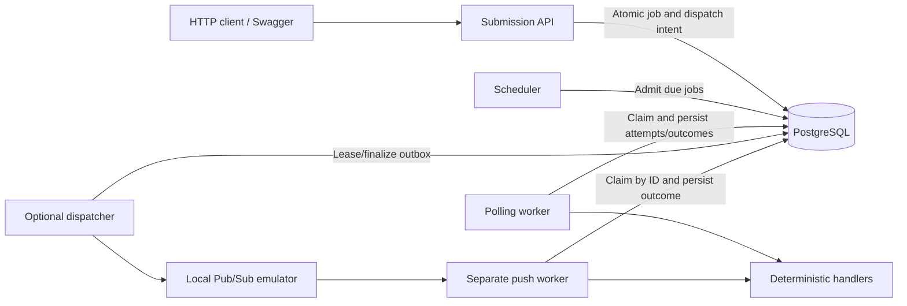

# Distributed Cloud Task Scheduler

A Python backend for durable asynchronous jobs, built around PostgreSQL
transactions, concurrent execution and explicit failure recovery. It supports
immediate and scheduled jobs, submission idempotency, bounded retries, retained
attempt history and priority with aging.

The project runs locally through Docker Compose and Swagger UI. Its core
correctness is tested against real PostgreSQL; performance and controlled
recovery experiments include reviewable raw records. Cloud deployment is outside
scope, and running the demo requires no cloud account or hosted service.

**Stack:** Python 3.12+, FastAPI, Pydantic, SQLAlchemy 2, psycopg, PostgreSQL 17,
Alembic, asyncio, Docker, pytest, Ruff and strict mypy.

## Architecture



The default demo uses the API, database, polling worker and scheduler. The
emulator transport is optional and shares the same execution ownership rules.

| Concern | Implementation and boundary |
| --- | --- |
| Durable acceptance | Immediate jobs and outbox obligations commit together. Scheduled jobs retain intent until atomic admission creates dispatch. |
| Concurrent claiming | Row locks with `FOR UPDATE SKIP LOCKED`; independent sessions and short transactions. |
| Ownership | Lease/token fencing prevents an obsolete worker from committing a newer owner's outcome. |
| Retries | Classified errors, persisted equal-jitter due times, bounded budgets and per-attempt history. |
| Exhaustion | Exhausted retryable work becomes `DEAD_LETTERED`; permanent failures become `FAILED`. |
| Manual recovery | A required generation fences reopening; prior history and immutable submission content remain intact. |
| Observability | Redacted structured events and bounded Prometheus metrics; metrics describe individual processes. |

Handlers execute outside database transactions. Publication also happens outside
the job transaction and can be repeated after ambiguous acceptance. Submission
idempotency and ownership fencing do not guarantee exactly-once external effects.
The in-memory local queue is not durable; `READY` outboxes establish intent rather
than broker acceptance.

## Quick start

Use Python 3.12+ and Docker Compose with a **local** Docker engine. For a fresh
checkout, install the development environment and copy the dummy configuration:

```powershell
python -m venv .venv
.venv\Scripts\python.exe -m pip install -e ".[dev]"
Copy-Item .env.example .env
```

On Linux/macOS, use `python3`, `.venv/bin/python` and `cp .env.example .env`.
Keep an existing `.env` intact. Choose local credentials and keep
`POSTGRES_PASSWORD`, `DATABASE_URL`, `COMPOSE_DATABASE_URL` and
`TEST_DATABASE_URL` consistent; URL-encode special password characters.
The [environment example](.env.example) contains dummy values, and `.env` is
excluded from Git and the image build.

With `postgres:17` and `distributed-cloud-scheduler:local` already available:

```powershell
docker compose --profile demo up -d --wait --pull never --no-build db
docker compose --profile demo run --rm --pull never api python -m alembic upgrade head
docker compose --profile demo up -d --wait --pull never --no-build api worker scheduler
```

For a first build or a stale application image, with the `python:3.12-slim-bookworm`
base already cached, run `docker build --pull=false -t distributed-cloud-scheduler:local .`.
Building installs declared Python dependencies and requires package availability or
internet access. The running application makes no cloud connection.

Open **[Swagger UI](http://127.0.0.1:8000/docs)**. The API and PostgreSQL ports
bind to loopback, defaulting to 8000 and 5433. Migrations are explicit; readiness
checks connectivity, not schema revision. One non-root image runs all application
roles. Compose without a profile starts only `db` and `api`; `demo` also enables
the continuous worker and scheduler.

Stop while retaining data with `docker compose --profile demo stop`.
Use `docker compose --profile demo down` to remove containers while retaining
the database volume. Adding `--volumes` erases local database data.

## API walkthrough

Submit a calculation, then read the returned job ID:

```powershell
$body = '{"type":"calculation","payload":{"numbers":[1,2,3]},"max_attempts":3,"priority":0}'
$job = Invoke-RestMethod -Uri http://127.0.0.1:8000/jobs -Method Post -ContentType 'application/json' -Body $body
Invoke-RestMethod -Uri "http://127.0.0.1:8000/jobs/$($job.id)"
```

Repeat the read request until the job reaches a terminal state. The calculation
finishes as `SUCCEEDED` with `result_metadata: {"sum": 6}`. The same operations
are available through Swagger's “Try it out”.

| Endpoint | Behavior |
| --- | --- |
| `POST /jobs` | `201` creates; matching submission-key replay returns `200`; conflicting content returns `409`. |
| `GET /jobs/{job_id}` | Current persisted job, result/error and lifecycle timestamps. |
| `GET /jobs` | Newest-first listing; `limit` 1–100, `offset` 0–10,000. |
| `GET /jobs/{job_id}/attempts` | Paginated history, optionally filtered by generation. |
| `POST /jobs/{job_id}/retry` | `202` reopens an eligible failed/dead-lettered generation; stale/ineligible requests return `409`. |
| `GET /health`, `GET /ready` | Process liveness and bounded PostgreSQL readiness. |
| `GET /metrics` | Process-local Prometheus exposition, outside Swagger. |

**Submission identity.** Supply a fresh `Idempotency-Key` in Swagger or as an
HTTP header, then repeat the same request: it returns the same job's current
state. Changing payload, type, attempt budget, original schedule or priority
under that key conflicts. Keys are case-sensitive, global within the database
and retained while jobs exist. No key creates a separate job for every request.

**Controlled retries.** Submit the following, then inspect attempt history:

```json
{"type":"controlled_failure","payload":{"fail_until_attempt":1},"max_attempts":3}
```

Attempt 1 records a retryable failure and its due time; attempt 2 succeeds with
`{"attempt": 2}`. Using `max_attempts: 1` produces one failed attempt and an
application dead letter with `attempts_exhausted` context. Manual recovery takes
`{"expected_generation": 0}` for a `FAILED` or `DEAD_LETTERED` generation-zero
job, opens generation 1 and preserves history. It keeps the payload and budget:
reopening that one-attempt workload fails again on its first attempt.

**Scheduling and priority.** Set `scheduled_at` to an explicit future RFC 3339
timestamp with an offset; the job stays `SCHEDULED` until the scheduler admits
it. Generate an example about 20 seconds ahead:

```powershell
.venv\Scripts\python.exe -c "from datetime import UTC, datetime, timedelta; print((datetime.now(UTC)+timedelta(seconds=20)).isoformat())"
```

Dates require an offset and at most six fractional digits. Past dates are allowed
and still require admission. PostgreSQL's clock governs eligibility; polling,
locks and capacity can delay execution after due.

Priority is immutable, from 0 to 9, default 0. Each level gives eligible database
candidates a five-second preference, capped at 45 seconds; older eligibility ages
ahead of fresh urgent work. Retries and manual recovery begin new eligibility
episodes. This policy does not promise preemption or global execution ordering.

Other handlers are `sleep` (`{"seconds": 0.05}`, at most 10 seconds) and
`calculation` (up to 1,000 finite numbers within ±1 billion). The API validates
bounded generic JSON; handler-specific validation occurs during execution.
Unknown types and invalid handler inputs become permanent failures.

Runtime settings live in [config.py](src/distributed_cloud_scheduler/config.py).
The worker defaults to concurrency 1, a 0.5-second idle poll, a 15-second task
timeout and a 60-second lease. Host commands read `.env`; Compose passes the
internal database URL. Supply other container overrides explicitly, for example:

```powershell
docker compose run --rm --pull never -e WORKER_CONCURRENCY=5 api python -m distributed_cloud_scheduler.worker
```

## Verification

As validated on **2026-10-10**, the local quality gate passed Ruff, strict mypy
for 22 source files and **1,125 tests with no skips**, including real PostgreSQL
migration, concurrency, cancellation, retry, ownership and recovery cases.
Alembic reported no schema drift. The host used Python 3.13.1; the container used
Python 3.12.15, which does not establish a full Python-version compatibility matrix.

Create the dedicated test database once, using the example's `scheduler` user
(or your configured `POSTGRES_USER`):

```powershell
docker compose exec db createdb -U scheduler scheduler_test
.venv\Scripts\python.exe scripts\check.py
.venv\Scripts\python.exe -m alembic check
```

Set `TEST_DATABASE_URL` to that database using the `postgresql+psycopg` driver;
its name must end in `_test` and differ from `DATABASE_URL`. Tests create and
remove their own random schemas. A missing test URL skips integration tests;
such a run does not validate database semantics. SQLite cannot validate these locks.
The [check script](scripts/check.py) runs local checks, with no hosted CI.

## Performance measurements

The recorded experiment used Windows 11, an Intel i5-14600KF (14 cores / 20
threads), 31.72 GiB host RAM and Docker Desktop's WSL2 VM (20 CPUs / 15.48 GiB).
Containers had database 2 CPU/512 MiB and API/worker 1 CPU/256 MiB ceilings,
with swap disabled. Runtime/image IDs, resolved package versions, source hashes,
commands and individual observations are in the raw artifacts. Interpreter paths
were normalized for publication; measured records are unchanged.

Each configuration measured three finite 300-job batches after 20 excluded warmup
jobs, with ten HTTP submitters and a 0.05-second worker poll. Calculation sums
0–999; sleep waits 50 ms. All **7,200 measured jobs succeeded** and reconciled
with one attempt and one outbox each; 480 warmup jobs were excluded.

Every table entry is the **median of three per-run statistics**, not a pooled
percentile. Throughput is successes divided by the full monotonic
submission-and-drain window. Latency is PostgreSQL creation-to-outcome time;
each run uses nearest-rank p50/p95/p99 over its 300 jobs.

| Workload | Concurrency | Jobs/s | Lifecycle p50 ms | p95 ms | p99 ms |
| --- | ---: | ---: | ---: | ---: | ---: |
| Calculation | 1 | 43.54 | 2341.04 | 4136.86 | 4253.30 |
| Calculation | 5 | 67.05 | 1151.54 | 1714.43 | 1772.36 |
| Calculation | 10 | 67.55 | 1286.23 | 1974.12 | 2060.40 |
| Calculation | 20 | 66.19 | 1196.52 | 2039.22 | 2097.38 |
| Sleep 50 ms | 1 | 14.38 | 9535.51 | 18152.13 | 18932.12 |
| Sleep 50 ms | 5 | 54.04 | 1959.55 | 3395.23 | 3507.96 |
| Sleep 50 ms | 10 | 70.91 | 1276.74 | 2118.23 | 2176.17 |
| Sleep 50 ms | 20 | 69.23 | 1466.40 | 2326.73 | 2468.22 |

The waiting workload improved about 4.93× from concurrency 1 to 10; concurrency
20 added no median improvement. Sampled worker CPU approached its one-core
budget, suggesting a constraint. Pool/lock waits were not separately profiled,
so the exact bottleneck remains unproven. The unchanged worker pool can retain
5 connections plus 10 overflow, independently of its execution slots.

[Performance suite JSON](docs/benchmarks/raw/2026-10-09/suite.json) contains
per-run summaries; [individual raw runs](docs/benchmarks/raw/2026-10-09) retain
HTTP, queue, claim-to-outcome and client timings, PostgreSQL records and resource
samples. Reproduce with a fresh output directory:

```powershell
.venv\Scripts\python.exe scripts\local_benchmark.py --output benchmark-results/local-01
```

Hard bounds are 1,000 measured jobs/run, 100 warmup jobs, five repetitions,
120 seconds per submission/drain window and 900 seconds/suite. These finite
bursts measure this pipeline on one host, not sustained-arrival capacity.
Calculation is tiny and sleep simulates waiting; neither measures CPU-heavy capacity.
Database timestamps precede commits; claim-to-outcome includes transaction
overhead. Client completion includes PostgreSQL polling. Docker resource samples
can include idle time after a short batch and omit complete host resource use.
The existing demo remained running during these measurements.

## Controlled recovery measurements

Three paired 300-job cohorts selected exactly 10% first-attempt failures using
seeds 20261010–20261012. Matching cohorts compared budgets of three and one,
with ordinary equal jitter at base/max 1 second, concurrency 5, ten submitters
and no warmup. All **1,800 jobs and 1,890 attempts/outboxes reconciled**.

| Cohort, three runs | First-attempt successes | Final successes | Dead letters | Attempts/outboxes | Automatic retries |
| --- | ---: | ---: | ---: | ---: | ---: |
| Recovery, budget 3 | 810/900 | 900/900 | 0 | 990 | 90 |
| Exhaustion control, budget 1 | 810/900 | 810/900 | 90 | 900 | 0 |

Recovered faults took median per-run p50/p95/p99 **1.012 / 1.726 / 1.730 seconds**
from first failed outcome to final successful outcome. Each of 90 recovered jobs
reconciled as chosen backoff + due-to-claim delay + final claim-to-outcome time.
The control has no recovery samples; its recovery quantiles are absent, not zero.
Each recovery run has only 30 samples, so its p99 is the observed maximum.

[Recovery suite JSON](docs/reliability/raw/2026-10-10/suite.json) and
[individual raw runs](docs/reliability/raw/2026-10-10) retain seeded index/UUID
mappings, outcomes, due times and complete histories. Reproduce with:

```powershell
.venv\Scripts\python.exe scripts\local_reliability.py --output reliability-results/local-01
```

Hard bounds are 10–1,000 jobs/cohort in multiples of ten, five repetitions,
120 seconds per submission/drain window and 900 seconds/suite. Only fault
membership is seeded; UUIDs, jitter and timings vary. Fresh workers and no warmup
prevent steady-state interpretation. Existing containers stayed stopped during
these measurements. All owned resources were removed; success and intentional
deadline-failure cleanup were validated without changing pre-existing resources.

These results cover controlled handler failures and application budgets.
Outboxes remained unpublished `READY`; this is durable intent and application
dead-letter evidence, not broker DLQ, worker-crash or dependency-outage recovery.
Neither experiment establishes an SLA, cloud reliability or exactly-once effects.

## Optional local Pub/Sub path

The [emulator Compose file](compose.pubsub.yaml) and
[SDK/push smoke](scripts/pubsub_smoke.py) exercise dispatch, duplicate delivery,
retries, recovery, scheduling and priority without cloud credentials.
With its emulator image already cached and the test database configured:

```powershell
docker compose -f compose.yaml -f compose.pubsub.yaml up -d --wait --pull never --no-build db pubsub
$env:PUBSUB_EMULATOR_HOST = '127.0.0.1:8681'
.venv\Scripts\python.exe scripts\pubsub_smoke.py --push-host host.docker.internal
docker compose -f compose.yaml -f compose.pubsub.yaml stop pubsub
```

The smoke owns temporary emulator resources and a disposable database schema.
Its push hostname must be reachable from the emulator. Cloud IAM, provisioning,
hosting and production delivery are outside this project's validated scope.

## Source map

- [Application package](src/distributed_cloud_scheduler): API, domain, execution,
  scheduler, outbox, transport and observability.
- [Migrations](migrations): explicit schema evolution and guarded compatibility.
- [Tests](tests): unit and PostgreSQL integration evidence.
- [Scripts](scripts): local verification, SDK smoke and bounded experiments.
- [Compose](compose.yaml) and [Dockerfile](Dockerfile): the local runtime.

The project has no frontend, account system, hosted CI or required cloud service.
Swagger/OpenAPI is the interface. Retention, fleet metrics and task-specific
external-side-effect idempotency remain future work.
