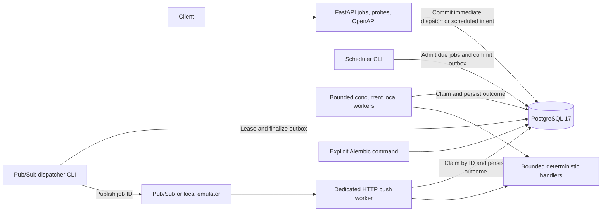

# Project status

- **Current milestone:** 11 - priority scheduling (COMPLETE).
- **Current state:** Milestones 0-11 pass their local acceptance criteria.
  PostgreSQL 17/emulator are healthy; revision 0009 has no host/container schema
  drift. The standard Python 3.13.1 checks pass all 842 tests without skips;
  Windows and Linux priority delivery smokes pass.
- **Next objective:** After authorization, design milestone 12's structured logs,
  metric meanings, correlation and redaction boundaries.
- **Session boundary:** Milestone 11 is complete; ask before starting milestone 12.
- **Git workflow:** Completed milestones 0-5 form one reviewed local checkpoint.
  Each subsequent milestone gets its own local commit after validation/documentation
  and before the continuation checkpoint, as required by AGENTS.md.
- **Updated:** 2026-10-09.

This document is the implementation source of truth. PROJECT_SPEC defines the
product; DECISIONS records significant choices. A milestone becomes COMPLETE only
after its acceptance criteria and validation pass. Stop progression when they do
not; update this document instead of advertising unfinished behavior.

# Architecture snapshot

The supported runtime is FastAPI, PostgreSQL 17, optional bounded local polling
workers, a Pub/Sub dispatcher CLI and a separate HTTP push worker. API/worker
resources belong to lifespan; async SQLAlchemy sessions are
operation-scoped. Explicit Alembic commands manage the schema; revision 0004 adds
the transactional dispatch outbox and backfills existing active jobs; revision
0005 adds optional unique submission keys and paired request fingerprints; revision
0006 adds retry due times and attempt history; revision 0007 adds generation fencing
and final dead-letter context; revision 0008 adds original scheduled dates and
indexed SCHEDULED admission intent. The scheduler CLI admits bounded due batches
using PostgreSQL locks, committing PENDING and a fresh outbox atomically. Revision
0009 adds immutable priority and internal readiness with UTC rank indexes. Scheduler,
polling and publication give each priority level five seconds of preference;
eligibility-based aging limits fresh urgent arrivals' head start to 45 seconds.
ID delivery stays specific and due/ownership gates remain authoritative. The API runs
on Windows or in a non-root Python 3.12 container. GCP has no role in local startup.

The publisher boundary and ID-specific execution path are exercised by real
PostgreSQL tests and live Google SDK/emulator HTTP delivery smokes on Windows and
Linux. Pub/Sub settings and SDK imports stay in transport/runtime modules.
`LocalQueue` remains an in-process test adapter, not a shared CLI broker.
POST /jobs commits immediate job/outbox or scheduled admission intent with HTTP 201,
or returns the current
job with 200 on matching keyed replay and 409 on conflicting content. Key metadata
is internal; database uniqueness coordinates independent API replicas.
Each claim inserts a history record. Transient outcomes with budget remaining
commit RETRY_WAIT and a new delayed outbox; polling and delivery only claim due
retries. Push ACKs committed retry intent and early duplicates, but due contention
remains 503. GET /jobs/{id}/attempts exposes paginated generation/attempt history
without ownership tokens. Exhausted transient errors become DEAD_LETTERED with final
context; permanent failures remain FAILED. Explicit manual recovery compares the
current generation and atomically opens a new budget with immediate dispatch,
preserving immutable submission identity and every earlier attempt/obligation.

# Milestones

## 0 - Planning and engineering foundation

- **Status:** COMPLETE.
- **Objective:** Establish an understandable, verifiable starting point.
- **Tasks:** Create AGENTS, PROJECT_SPEC, PLAN, DECISIONS and README; define the
  src package layout, pyproject, development dependencies, ignores and one portable
  verification script. Inspect the roadmap for unnecessary complexity.
- **Design questions:** Keep tooling usable on Windows and Linux without requiring
  Make, a cloud account or a new dependency manager.
- **Acceptance:** Editable installation succeeds on Python 3.12+; package imports;
  `python scripts/check.py` runs Ruff, strict application mypy and pytest successfully;
  docs distinguish implemented functionality from planned work.
- **Validation:** Install into a clean project venv; run the package smoke test and
  standard command; inspect docs and Git diff for consistency.

## 1 - FastAPI and PostgreSQL foundation

- **Status:** COMPLETE.
- **Objective:** Prove a locally runnable service and migration path.
- **Tasks:** Add typed environment configuration, app factory and lifespan, /health,
  /ready, SQLAlchemy async engine/session setup, Alembic baseline, Docker Compose
  PostgreSQL and API, environment example, database integration fixtures and setup docs.
- **Design questions:** Liveness stays independent of PostgreSQL; readiness must
  actually query it and fail within a bounded timeout. Migrations run explicitly,
  independently of API replicas. Do not invent domain tables yet.
- **Acceptance:** API and PostgreSQL start locally; /health returns 200; /ready returns
  200 with the database and 503 without it; engine is disposed at shutdown; baseline
  migrations upgrade, downgrade and re-upgrade; standard checks pass.
- **Validation:** Unit tests for configuration and probes/lifecycle; real PostgreSQL
  connectivity and migration tests; Compose configuration/build/start and HTTP smoke.

## 2 - Job domain and persistence

- **Status:** COMPLETE.
- **Objective:** Submit and inspect jobs without dispatching them.
- **Tasks:** Define a justified lifecycle, Job model, UTC timestamps, JSON payload,
  constraints/indexes and migration; input/output schemas and focused data access;
  POST /jobs, GET /jobs/{id}, and bounded/paginated GET /jobs.
- **Design questions:** Valid types/payload limits, immutable submission data, legal
  transitions, list ordering/pagination, error contract, and future key uniqueness.
- **Acceptance:** Valid submissions persist PENDING jobs; invalid input is rejected;
  missing IDs return 404; listing is bounded and stable; no execution or queue side
  effect occurs; migration and standard checks pass.
- **Validation:** Domain validation tests, real PostgreSQL API CRUD/constraint tests,
  migration round trip and OpenAPI examples.

## 3 - Local execution path

- **Status:** COMPLETE.
- **Objective:** Prove selection -> atomic claim -> execution -> persisted outcome.
- **Tasks:** Add a local worker entry point, small deterministic handlers (calculation,
  bounded sleep, controlled failure), claim transactions and explicit transitions.
  Define stale ownership/crash behavior before claiming reliability.
- **Design questions:** Row locking/CAS, transaction boundaries, ownership tokens,
  execution outside transactions, and time limits.
- **Acceptance:** Claimed jobs succeed or record a classified failure; contenders
  cannot simultaneously own one job; execution does not hold a long DB transaction.
- **Validation:** Success, exception, contention and terminal-transition integration
  tests against PostgreSQL; local end-to-end submission/execution smoke.

## 4 - Concurrent workers

- **Status:** COMPLETE.
- **Objective:** Bound concurrent execution and stop safely.
- **Tasks:** Configure asyncio concurrency, isolate per-task sessions, handle signals,
  drain/cancel deliberately, and implement the chosen stale-claim recovery semantics.
- **Design questions:** I/O vs CPU workloads; pool sizing; lease duration and fencing;
  cancellation and external effects that cannot be rolled back.
- **Acceptance:** Multiple workers handle jobs without double ownership; active work
  stays within the limit; shutdown/recovery behavior is documented and demonstrated.
- **Validation:** Barrier-based contention tests, multiple-process workers, bounded
  concurrency, cancellation and shutdown/restart scenarios.

## 5 - Queue boundary

- **Status:** COMPLETE.
- **Objective:** Separate transport from execution using a small real-use interface.
- **Tasks:** Extract publish/delivery adapters and add a local/test implementation;
  use job IDs in messages; design and implement durable dispatch reconciliation
  (transactional outbox or justified alternative) before cloud publishing.
- **Design questions:** A database commit and publish are not one atomic transaction;
  distinguish broker acknowledgement from job success; avoid generic queue frameworks.
- **Acceptance:** Existing execution tests remain valid; publication interruptions
  cannot silently strand committed jobs; duplicate dispatch is safe at the claim layer.
- **Validation:** Adapter/backpressure tests; real PostgreSQL atomicity, publication
  failure/backoff/replay, concurrent dispatch, duplicate claims and lock-wait expiry
  tests; migration backfill/round trip and live host/container delivery smokes.

## 6 - Google Pub/Sub integration

- **Status:** COMPLETE (local SDK/emulator integration; cloud deployment deferred).
- **Objective:** Deliver persisted job IDs through a Cloud Run-compatible push endpoint.
- **Tasks:** Add publisher and validated push envelope adapter, HTTP acknowledgement
  behavior, local/emulator tests where supported, and a bounded task execution policy.
- **Design questions:** Push authentication, duplicate/out-of-order delivery, message
  size, request deadlines, malformed messages and transport outages.
- **Acceptance:** The real Python Pub/Sub SDK publishes canonical UUID bytes through
  the existing outbox. A wrapped push ID loads authoritative DB state, claims,
  executes and persists an outcome before HTTP 204. Terminal duplicates return 204;
  live/contended ownership, full capacity, request timeout and dependency failures
  return 503. Unknown IDs return 404; malformed/oversized envelopes return 400/413.
  Non-success responses request broker redelivery. Targeted expired ownership becomes
  FAILED/worker_lost before acknowledgement, without re-execution or unrelated recovery.
  No domain GCP imports or new database schema. The public API remains a separate runtime.
- **Validation:** Standard checks with no database skips; publisher/envelope/config
  tests; real PostgreSQL push success/failure, concurrent duplicates, ownership expiry,
  claim/completion failures, lock contention, bounded admission and cancellation tests;
  migration round trip and schema drift; real SDK -> emulator -> live HTTP worker ->
  PostgreSQL smoke on Windows and Linux, including replay and broker outage recovery.
  Cloud smoke is conditional on an authorized cloud environment, absent in this session.

## 7 - Submission idempotency and duplicate delivery

- **Status:** COMPLETE.
- **Objective:** Guarantee one logical submission per key under concurrency.
- **Tasks:** Idempotency-Key, canonical request fingerprint, PostgreSQL uniqueness,
  matching replay and conflicting-key response; strengthen worker duplicate handling.
- **Design questions:** Key scope, retention, normalization and races; exactly-once
  external effects cannot be inferred from one DB claim.
- **Acceptance:** Optional single `Idempotency-Key` accepts 1-128 ASCII letters,
  digits or `._:-`, with exact case-sensitive global scope and no trimming/expiry.
  No-key submissions remain independent HTTP 201 jobs. A new keyed submission
  returns 201; matching replay returns the same job's current representation with
  200; different validated type/payload/max_attempts returns sanitized 409.
  Fingerprints include defaults, sort nested object keys and preserve array/string
  and parsed numeric representation distinctions (1 differs from 1.0; signed float
  zero differs). Invalid/duplicate headers return 422 without creating rows.
  Concurrent submissions leave exactly one job and one outbox obligation per key;
  rollback or cancellation before committing an incomplete insert leaves the key
  reusable. A lost/ambiguous commit response is resolved by retrying the same key.
  Duplicate transport/polling claims
  cannot add an owned attempt or replace a terminal outcome. Existing rows survive
  migration with NULL idempotency metadata, and public responses do not expose keys/hashes.
- **Validation:** Canonicalization/header/OpenAPI unit tests; real PostgreSQL API
  replay/conflict and independent-app contention, observed unique-index waiting
  behind committed/rolled-back winners, outbox failure atomicity and cancellation;
  duplicate delivery across independent push engines and polling; migration 0005
  upgrade/downgrade/re-upgrade preserving jobs/outbox and direct constraint tests;
  standard checks without skips, schema drift, and live Windows/Linux API + emulator
  replay/duplicate smokes. No cloud provisioning or execution retries in this milestone.

## 8 - Failure and retry semantics

- **Status:** COMPLETE.
- **Objective:** Make one deliberate model control execution attempts.
- **Tasks:** Decide retry authority before implementation; record attempt history,
  classify transient/permanent errors, cap attempts and add backoff with bounded jitter.
- **Design questions:** Application attempts vs broker delivery attempts, durable retry
  scheduling, acknowledgement after failure, leases and retry storms.
- **Acceptance:** PostgreSQL owns execution attempts independently of broker delivery
  and publication counts. Each committed claim creates one RUNNING attempt record;
  completion or expired-owner recovery finalizes that record atomically with job state.
  Retryable errors (controlled failure, timeout, internal error, cancellation and
  worker loss) schedule RETRY_WAIT only while attempt_count < max_attempts; otherwise
  FAILED is terminal. Invalid payload/unknown task are permanent and never retried.
  A scheduled retry commits next_attempt_at and a new outbox obligation with that
  same due time in the outcome transaction. Polling and ID claims cannot execute
  before the database due time. Duplicates cannot move due times, add history,
  consume attempts early or overwrite a newer attempt. Old publisher finalization
  cannot bypass due gating. Equal jitter stays within half/full capped exponential
  delay, chosen once and persisted; restart does not recompute it.
  Push returns 204 after committed terminal state or durable RETRY_WAIT, including
  early retry duplicates; active ownership/contention, lost completion, timeout and
  database failures remain 503. Stale tokens stay fenced across retries/recovery.
  GET /jobs/{id}/attempts returns ordered bounded history without ownership tokens;
  job responses include next_attempt_at. Migration preserves existing jobs/outbox,
  leaves historical terminal jobs terminal and backfills only known active ownership.
  No manual retry, dead-letter policy, general delayed submissions or cloud resources.
- **Validation:** Pure backoff/config/classification tests; real PostgreSQL transient
  success, exhaustion/permanent failures, due gating, replicas/polling/push races,
  outcome/outbox/history rollback, restart, crash/lease recovery and stale finalization;
  migration upgrade/downgrade/re-upgrade and constraints; standard venv checks without
  skips, host/container schema drift and live Windows/Linux emulator retry smokes.

## 9 - Dead-letter handling

- **Status:** COMPLETE.
- **Objective:** Make exhausted jobs inspectable and intentionally recoverable.
- **Tasks:** Define application vs broker dead-letter responsibilities; persist final
  failure context; add POST /jobs/{id}/retry with explicit eligible states.
- **Design:** PostgreSQL remains authoritative. A retryable error at the execution
  budget limit becomes DEAD_LETTERED with reason attempts_exhausted, database-clock
  dead_lettered_at and the final safe error/attempt record. Permanent errors remain
  FAILED. Broker dead-letter forwarding quarantines undeliverable transport messages;
  it never determines execution counts or changes job state. Production policy/IAM
  provisioning remains milestone 15.
- **Acceptance:** POST /jobs/{id}/retry accepts a strict body containing
  expected_generation (integer 0..2147483647). Only FAILED/DEAD_LETTERED jobs with
  that current generation may reopen. Under one row lock, increment generation,
  reset attempt_count, current outcome/timing/ownership/dead-letter fields and insert
  an immediate outbox obligation in one transaction; preserve type, payload,
  max_attempts, creation time, submission key/fingerprint and all earlier history.
  Return 202; unknown IDs return 404, stale/ineligible/overflow requests 409,
  invalid bodies 422 and unavailable database 503. Concurrent commands have one
  winner; repeating an old command cannot reopen a later terminal generation.
  Generations begin at zero and have separate 1..20 attempt budgets. Claims and
  dispatch records carry generation; stale finalization cannot alter a reopened
  job, and old READY obligations are skipped. ID-only transport may claim the
  current eligible generation because the database owns execution authority.
  GET /jobs/{id}/attempts returns chronological generation/attempt history with
  bounded limit/offset and optional generation filter; ownership tokens stay private.
  Terminal duplicate deliveries ACK without mutation. Migration 0007 preserves
  historical statuses/context as generation zero; unknown legacy dead-letter
  metadata stays NULL. Downgrade refuses after any manual recovery generation exists
  rather than deleting retained history or silently reverting reopened work.
- **Validation:** Standard venv checks with no skips; real PostgreSQL exhaustion,
  permanent failure/worker loss, terminal duplicate delivery, manual success and
  repeated failure, independent-engine concurrent retry, stale CAS commands,
  transaction rollback/cancellation, keyed replay, history pagination, old outbox
  publication and stale-owner fencing. Migration upgrade/downgrade/re-upgrade,
  downgrade guard including concurrent recovery and direct constraints;
  host/container schema drift; Windows/Linux
  live API -> SDK -> emulator -> push dead-letter/manual-recovery smokes.

## 10 - Delayed jobs and scheduler

- **Status:** COMPLETE.
- **Objective:** Dispatch only due jobs with restart-safe scheduling.
- **Tasks:** scheduled_at support, due-row index/query, bounded scheduler batches and
  safe claims/reconciliation; introduce a scheduler runtime entry point.
- **Design:** Optional scheduled_at is an aware datetime normalized to UTC. HTTP
  input uses RFC 3339 with explicit offset/Z and at most six fractional digits;
  naive/date-only/numeric/invalid/leap-second/UTC-overflow input is rejected. Past dates are
  allowed. All non-NULL scheduled submissions enter SCHEDULED with no outbox;
  the row itself is durable admission intent. Omitted/NULL dates keep immediate
  PENDING + outbox behavior. No recurring schedules or schedule-edit API.
- **Acceptance:** Scheduler schedule_due(database, limit=100) uses PostgreSQL clock,
  ordered scheduled_at/id selection, a bounded 1..1000 batch and FOR UPDATE SKIP
  LOCKED. In one transaction it changes due SCHEDULED rows to PENDING and inserts
  exactly one current-generation outbox per admitted job. Rollback/cancellation
  preserves scheduling intent; competing/restarted schedulers cannot double admit.
  SCHEDULED never executes; initial-generation PENDING/QUEUED claims also guard the
  original database due time. Early SCHEDULED ID deliveries ACK durable admission
  intent even when due; admission commit supplies new dispatch, rollback retains
  SCHEDULED. Active/due execution contention still NACKs. Automatic retries retain
  next_attempt_at authority; manual recovery retains the original scheduled_at and
  opens an immediate new generation. Public job reads expose the original UTC date.
  Fingerprints omit NULL/absent scheduled_at, preserving all D011 hashes. Non-NULL
  dates hash a normalized UTC ISO string with six fractional digits; equivalent
  instants replay, different dates conflict, and the original digest remains immutable.
  Scheduler CLI supports --once (one batch) or polling, portable stop/drain/cancel,
  database outage retry and engine cleanup without broker imports. Settings bound
  batch size, poll interval and shutdown timeout. Partial due index and migration
  0008 preserve legacy rows; downgrade locks before checking and refuses while any
  non-NULL scheduled_at remains, including completed jobs, protecting schedule/key
  semantics. Hosted scheduler invocation/CPU policy is deferred to milestone 15.
- **Validation:** Standard venv checks without skips; strict datetime/hash/config
  and runtime tests; real PostgreSQL future/due gating, bounded ordered admission,
  independent scheduler/worker/push races, restart, atomic rollback/cancellation,
  keyed replay across upgrades, retry/manual recovery and stale generation fencing.
  Migration round trips/direct constraints/concurrent downgrade guard, host/container
  schema drift, and Windows/Linux live API -> scheduler CLI -> dispatcher -> SDK ->
  emulator -> push smokes, including early ID ACK and restart before due admission.

## 11 - Priority scheduling

- **Status:** COMPLETE.
- **Objective:** Implement an honest, limited scheduling priority policy.
- **Tasks:** Evaluate DB dispatch ordering vs broker realities; define ties and starvation
  policy, then add the minimum priority fields/indexes and ordering.
- **Design:** Immutable strict integer priority 0..9, default 0; higher values get
  five seconds of head start per level, at most 45 seconds. Among due, unlocked
  candidates order by (eligibility in UTC minus priority * five seconds), then
  eligibility timestamp and UUID. This static rank equals linear aging without
  timers, mutable scores or process-local counters. Continually eligible unlocked
  work older than the maximum head start ranks ahead of fresh urgent arrivals;
  capacity, a progressing selector and the database clock are required. No finite
  wall-time, global execution-order, preemption or broker-priority guarantee.
- **Acceptance:** Scheduler admission and local polling use internal jobs.ready_at.
  Submission initializes it to greatest(database creation time, scheduled_at), or
  creation time if immediate; past dates cannot invent age. Admission/publication
  retain it. Automatic retry resets it to next_attempt_at; manual recovery resets
  it to current PostgreSQL time while retaining original priority/date/hash/history.
  Existing status, due-time, attempt budget and ownership predicates stay authoritative;
  aging never makes a future job/retry eligible. ID-specific push/claims execute
  their delivered eligible ID regardless of other jobs' priority.
  Dispatch joins immutable Job.priority without locking jobs and uses available_at
  for READY, lease_expires_at for reclaimable PUBLISHING; FOR UPDATE OF dispatch_outbox
  SKIP LOCKED preserves outbox-before-job lock order. Publication backoff/reclaimed
  leases start a new dispatch eligibility episode. No priority is copied into broker
  messages or outbox rows. Equal ranks use eligibility/UUID, and locked rows may reorder.
  Public input/reads expose priority; ready_at remains internal and caller-controlled
  fields remain rejected. Default/omitted priority is excluded from hashing, preserving
  every D011/D014 digest; nonzero priority participates in immutable submission identity.
  Migration 0009 adds default-zero priority/range constraint, internal readiness and
  partial UTC rank indexes for scheduled/available jobs; retain existing due/lease
  indexes. Backfill readiness from retry due times, current-generation recovery outbox
  creation time, or greatest(original creation, schedule). Preserve existing records,
  original fingerprints, history and obligations. Default-only downgrade roundtrips;
  lock all three tables before guarding and refuse any nonzero priority, including
  terminal jobs, to protect original submission identity. Coordinate stopped runtimes.
- **Validation:** Standard venv checks without skips; strict input/OpenAPI/hash tests
  pinned to actual prior immediate/scheduled digests; real PostgreSQL mixed priority,
  rank/timestamp/UUID ties, sustained urgent arrivals with aged-low progress, locked
  rows, independent selector contention, future/retry gating, lease reclamation,
  targeted low-ID execution and retry/manual age reset. Verify ordering independent
  of session timezone and new indexes against PostgreSQL. Migration roundtrips,
  backfill/default/range constraints, concurrent downgrade guard and schema drift;
  Windows/Linux API -> scheduler/worker/dispatcher CLI -> SDK/emulator/push smokes
  demonstrate database selection, without asserting broker arrival/completion order.

## 12 - Observability

- **Status:** NOT STARTED.
- **Objective:** Explain job outcomes and latency with useful evidence.
- **Tasks:** Structured logs with job/type/service/attempt/status/duration/error context;
  counters, active execution, retry/dead-letter counts and latency histograms.
- **Design questions:** Cloud-appropriate exporters, label cardinality, payload/secret
  redaction, process-local vs fleet metrics.
- **Acceptance:** A job can be followed across submission, dispatch and attempts;
  p50/p95/p99 and error/throughput measures have defined meanings.
- **Validation:** Logging/redaction tests, metric invariants and sample end-to-end traces.

## 13 - Integration and failure testing

- **Status:** NOT STARTED.
- **Objective:** Validate system invariants across realistic interruptions.
- **Tasks:** Consolidate PostgreSQL/broker test fixtures and critical end-to-end cases:
  duplicates, exceptions, transient failures, exhaustion, contention, worker crash,
  delayed jobs, scheduler duplication and shutdown. Retain regressions discovered earlier.
- **Design questions:** Deterministic synchronization and fault injection; avoid public
  internet dependencies and mocks that conceal transaction behavior.
- **Acceptance:** Critical scenarios assert durable state and allowed effects; known
  limitations are recorded and reproducible.
- **Validation:** Repeatable integration/failure suite plus all standard checks.

## 14 - Production containerization

- **Status:** NOT STARTED.
- **Objective:** Harden the existing development image for deployable runtimes.
- **Tasks:** One reusable image with explicit API/worker/scheduler commands, non-root
  runtime, minimal dependencies, signal handling and appropriate probes.
- **Design questions:** Migration job separate from replicas; CPU/memory limits,
  Python version and image reproducibility.
- **Acceptance:** Built images run the three relevant roles and stop correctly without
  shipping development dependencies or secrets.
- **Validation:** Image build, runtime/probe/shutdown smoke and configuration inspection.

## 15 - Terraform and GCP deployment

- **Status:** NOT STARTED.
- **Objective:** Provision a minimal explainable cloud system after behavior stabilizes.
- **Tasks:** Required APIs, Artifact Registry, Pub/Sub/DLQ as chosen, Cloud SQL, Cloud Run
  roles, scheduler hosting, IAM and secrets; deploy/runbook and teardown instructions.
- **Design questions:** Least privilege, push OIDC, DB connection budget, public demo
  exposure, regionality and cost; ask before spending materially or irreversible changes.
- **Acceptance:** Terraform validates/plans; a reviewed authorized deployment runs
  submission through terminal state; no credentials in source/state artifacts in Git.
- **Validation:** fmt/validate/plan and cloud end-to-end smoke when credentials and cost
  authorization exist. Without them this milestone remains incomplete.

## 16 - GitHub Actions

- **Status:** NOT STARTED.
- **Objective:** Automate equivalent local quality gates, then authorized deployment.
- **Tasks:** PR lint/types/tests/build with PostgreSQL services; reproduce the standard
  check command; add image publication/deployment separately with workload identity.
- **Design questions:** Protect deployment environments, avoid stored service-account
  keys, cache safely and pin CI dependencies. Tooling is established earlier; CI waits here.
- **Acceptance:** PR checks run reproducibly; deployment automation is validated only
  when a cloud environment exists and publication is authorized.
- **Validation:** Local workflow-equivalent commands and actual workflow run results.

## 17 - Load tests and benchmarks

- **Status:** NOT STARTED.
- **Objective:** Measure scaling and identify the real bottleneck.
- **Tasks:** Select a justified load tool; define deterministic workloads; compare
  concurrency 1/5/10/20; record raw output and environment/configuration methodology.
- **Design questions:** Separate queue/execution/end-to-end latency, warmup, saturation,
  DB/broker limits, fairness and CPU vs I/O workloads.
- **Acceptance:** Reproducible jobs/s, p50/p95/p99, failure rate and resource measurements;
  honest interpretation explains nonlinear scaling.
- **Validation:** Repeat benchmark runs with bounded duration/cost and documented variance.

## 18 - Reliability experiment

- **Status:** NOT STARTED.
- **Objective:** Quantify recovery under controlled transient failures.
- **Tasks:** Reproducible approximately 10% fault injection; measure initial/eventual
  completion, attempts per job, dead-letter rate and time to success; publish methodology.
- **Design questions:** Seeded fault schedules, independent error categories, incomplete
  observation windows and consistency with the configured retry budget.
- **Acceptance:** Raw results reconcile with DB attempt records; conclusions distinguish
  guarantees from experimental outcomes.
- **Validation:** Controlled runs and accounting invariants using the failure suite.

## 19 - Optional C++ worker experiment

- **Status:** NOT STARTED (OPTIONAL; gated on 0-18 completion).
- **Objective:** Compare equivalent CPU-bound work only if it adds evidence.
- **Tasks:** Choose one hashing/prime/transformation workload and equivalent implementations;
  record environment, compiler/runtime options, correctness and raw benchmark results.
- **Design questions:** IPC/transport overhead and fair inputs/resources; skip entirely if
  it distracts from the primary project.
- **Acceptance:** Correctness-equivalent CPU workloads and honest measurements; no claims
  based on sleep or network-bound work.
- **Validation:** Cross-language result comparisons and repeated controlled benchmarks.

# Current milestone details

Milestone 11 implements D015: immutable strict priority 0..9, default 0, with a
fixed five-second head start per level. Database selectors rank eligible UTC time
minus priority * five seconds, then eligibility timestamp and UUID. Continually
eligible unlocked work older than the maximum 45-second head start ranks ahead
of fresh urgent arrivals; capacity, advancing database time and selector progress
are required. This is a limited selection policy, without global execution order,
preemption or a finite wall-time service guarantee.

Internal Job.ready_at begins at greatest(database creation, original schedule).
Initial past dates invent no age. Admission/publication retain readiness; automatic
retry resets it to next_attempt_at and manual recovery resets it to current database
time. Priority/date/hash/history persist across generations. Default-priority
selection now orders readiness episodes rather than historical creation or requested
past dates. Listing remains creation-ordered, and ID-specific execution remains
independent of other jobs' priorities. Due/status/budget/ownership gates are unchanged.

Dispatch joins immutable Job.priority, ranking READY by available_at and expired
PUBLISHING by lease_expires_at. Only outbox rows are locked, preserving existing
finalization lock order. Broker messages and outbox schema stay unchanged; joined
sorting cost remains benchmark work. Two partial UTC rank indexes support job
selection while existing due/lease indexes remain.

Effective priority 0 is omitted from fingerprints, preserving every retained
D011/D014 digest. Nonzero priorities contribute immutable submission content.
Migration 0009 backfills known retry/recovery/initial readiness, without changing
existing records or identity. Locked downgrade refuses any nonzero priority,
including completed jobs; default-only records can return to 0008. No new dependency,
cloud resource, recurring schedule or edit API is introduced.

Validation completed on 2026-10-09:

- Standard venv `python scripts/check.py`: Ruff passes, strict mypy passes for 21
  source files and all 842 tests pass without skips in 124.50 seconds. Includes
  25 new priority unit cases and 40 real PostgreSQL priority cases: mixed levels,
  exact 44/45/46-second boundaries, deterministic readiness/UUID ties, 12 selector
  passes with 36 fresh urgent arrivals and aged-low progress, locked-row skipping,
  independent ownership, due/lease gating, targeted low-ID execution, timezone
  independence, retry/manual age resets and pinned pre-upgrade submission replays.
- All 15 PostgreSQL priority migration tests pass legacy record/hash preservation,
  readiness backfill/default/range/null constraints, repeated round trips, usable
  UTC rank indexes across UTC/Warsaw/Lord Howe session timezones, nondefault terminal
  downgrade refusal and concurrent submission fencing. Revision 0008's original
  schedule guard remains intact. Application is at 0009; host and rebuilt container
  schema drift checks report no new operations.
- Windows/Python 3.13.1 and Linux/Python 3.12.15 live API -> scheduler/worker/dispatcher
  CLI -> SDK/emulator -> push smokes pass mixed priority publication, equal-rank UUID ties, targeted
  low-ID execution and aged-low progress during fresh urgent arrival passes.
  Explicit priority-0 replay retains original keyed identity; all prior probes pass
  and disposable resources clean up. Compose configuration and host/container pip
  checks pass; the non-root Linux image builds and runs the same policy.

Cloud scheduler invocation/CPU policy and broker DLQ/IAM remain deployment-stage
validation in milestone 15. Local polling makes no cloud hosting claim.

The roadmap is intentionally sequential. Basic atomic claiming is required before
concurrency, and durable publication/reconciliation is required before Pub/Sub.
API idempotency at milestone 7 does not defer safe worker ownership from milestone 3.
Failure/concurrency tests begin with the relevant implementation; milestone 13 extends
them and does not postpone correctness testing.

# Decisions affecting upcoming work

- D001: staged local-first implementation and the specified stack.
- D002: PostgreSQL is authoritative; use explicit transactions and constraints.
- D003: async SQLAlchemy/psycopg with explicit migrations and isolated sessions.
- D004: Pub/Sub push / Cloud Run is provisional; delivery can be duplicated.
- D005: portable tooling and explicit Windows-compatible asyncio loop selection.
- D006: persistence-only job API, strict JSONB inputs and bounded offset pagination.
- D007/D008: database token/lease ownership, bounded loops and graceful draining.
- D009: transactional dispatch outbox, replayable publication and separate attempt budgets.
- D010: separate Pub/Sub runtimes, bounded push requests and ACK after durable terminal state.
- D011: global optional submission keys, original content fingerprints and atomic job/outbox replay.
- D012: application attempt authority, persisted retry timing/history and atomic replacement dispatch.
- D013: explicit dead-letter exhaustion, generation-fenced manual recovery and retained history.
- D014: durable scheduled admission, database-clock eligibility and compatible schedule identity.
- D015: bounded priority preference, eligibility-episode aging and unchanged ID authority.

# Risks / technical debt

- Milestones 0-11's local acceptance checks pass. Cloud IAM/provisioning/delivery remain
  deployment-stage validation, not evidence supplied by the emulator.
- No cloud environment or spending authorization has been established. Cloud rollout
  must not be claimed validated from local tests.
- Cloud IAM, broker DLQ operations and dispatcher/scheduler hosting still need
  deployment/reliability decisions. Priority cannot impose global broker execution order.
- `LocalQueue` loses buffered messages on process exit. The outbox is durable, but
  marking acceptance requires a transport whose acceptance guarantees fit deployment.
  A dispatcher must be invoked to publish/replay obligations; local tests do not
  establish a durable broker guarantee or a hosted dispatcher.
- Outbox/job retention and cleanup remain future work. Keys have no expiry and
  remain bound while jobs exist; future submission fields/fingerprint changes need
  an explicit compatibility decision for existing key bindings.
- At-least-once delivery does not imply exactly-once external side effects. Keep handlers
  deterministic while ownership and failure semantics are developed.
- History begins at migration 0006; only known active ownership is backfilled.
  A legacy RUNNING record with zero attempts was never produced by application
  claims and requires investigation rather than invented history. Coordinated
  upgrades are required; revision 0006 downgrade stops waiting retries and removes history/timing.
- Milestone 9 introduces retry generations to retain history across budget resets;
  coordinated upgrade is required, and downgrade will be refused after manual recovery.
- Original scheduled_at has no edit/retention API. Migration 0008 downgrade refuses
  while any original date remains, including completed work. PostgreSQL clock defines
  due eligibility; host clock, polling and broker ordering do not define execution time.
- Nonzero priority belongs to retained submission identity; migration 0009 downgrade
  refuses while it exists. The fixed five-second quantum/range and rank indexes
  need coordinated changes. Joined dispatch sorting still needs benchmark evidence.
- Host tests use Python 3.13.1; container runtime smokes use Python 3.12.15. This
  evidence does not establish a full Python-version test matrix.

# Next actions

1. Ask whether to start milestone 12; do not implement it before authorization.
2. If authorized, define correlation/log redaction and metric meanings before behavior.
3. Keep cloud hosting/DLQ/IAM in milestone 15; benchmark query costs at milestone 17.
