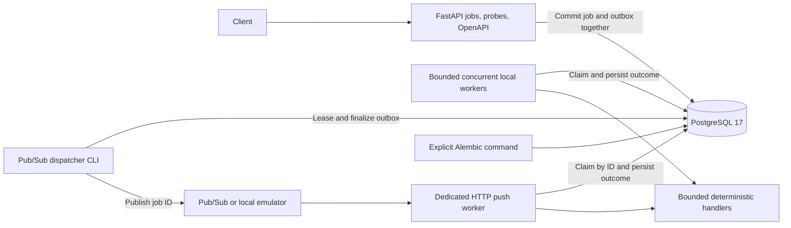

# Project status

- **Current milestone:** 6 - Google Pub/Sub integration (COMPLETE).
- **Current state:** Milestones 0-6 are validated locally. The Pub/Sub dispatcher
  publishes durable obligations; a separate bounded HTTP worker commits outcomes
  before ACK. Windows/Linux SDK-emulator delivery and failure recovery pass.
- **Next objective:** Milestone 7 - submission idempotency and duplicate delivery (NOT STARTED).
- **Session boundary:** Milestone 6 is tied off; ask before starting milestone 7.
- **Git workflow:** Completed milestones 0-5 form one reviewed local checkpoint.
  Each subsequent milestone gets its own local commit after validation/documentation
  and before the continuation checkpoint, as required by AGENTS.md.
- **Updated:** 2026-10-06.

This document is the implementation source of truth. PROJECT_SPEC defines the
product; DECISIONS records significant choices. A milestone becomes COMPLETE only
after its acceptance criteria and validation pass. Stop progression when they do
not; update this document instead of advertising unfinished behavior.

# Architecture snapshot

The supported runtime is FastAPI, PostgreSQL 17, optional bounded local polling
workers, a Pub/Sub dispatcher CLI and a separate HTTP push worker. API/worker
resources belong to lifespan; async SQLAlchemy sessions are
operation-scoped. Explicit Alembic commands manage the schema; revision 0004 adds
the transactional dispatch outbox and backfills existing active jobs. The API runs
on Windows or in a non-root Python 3.12 container. GCP has no role in local startup.

The publisher boundary and ID-specific execution path are exercised by real
PostgreSQL tests and live Google SDK/emulator HTTP delivery smokes on Windows and
Linux. Pub/Sub settings and SDK imports stay in transport/runtime modules.
`LocalQueue` remains an in-process test adapter, not a shared CLI broker.

# Milestones

## 0 - Planning and engineering foundation

- **Status:** COMPLETE.
- **Objective:** Establish an understandable, verifiable starting point.
- **Tasks:** Create AGENTS, PROJECT_SPEC, PLAN, DECISIONS and README; define the
  src package layout, pyproject, development dependencies, ignores and one portable
  verification script. Inspect the roadmap for unnecessary complexity.
- **Design questions:** Keep tooling usable on Windows and Linux without requiring
  Make, a cloud account or a new dependency manager.
- **Acceptance:** Editable installation succeeds on Python 3.12+; package imports;
  `python scripts/check.py` runs Ruff, strict application mypy and pytest successfully;
  docs distinguish implemented functionality from planned work.
- **Validation:** Install into a clean project venv; run the package smoke test and
  standard command; inspect docs and Git diff for consistency.

## 1 - FastAPI and PostgreSQL foundation

- **Status:** COMPLETE.
- **Objective:** Prove a locally runnable service and migration path.
- **Tasks:** Add typed environment configuration, app factory and lifespan, /health,
  /ready, SQLAlchemy async engine/session setup, Alembic baseline, Docker Compose
  PostgreSQL and API, environment example, database integration fixtures and setup docs.
- **Design questions:** Liveness stays independent of PostgreSQL; readiness must
  actually query it and fail within a bounded timeout. Migrations run explicitly,
  independently of API replicas. Do not invent domain tables yet.
- **Acceptance:** API and PostgreSQL start locally; /health returns 200; /ready returns
  200 with the database and 503 without it; engine is disposed at shutdown; baseline
  migrations upgrade, downgrade and re-upgrade; standard checks pass.
- **Validation:** Unit tests for configuration and probes/lifecycle; real PostgreSQL
  connectivity and migration tests; Compose configuration/build/start and HTTP smoke.

## 2 - Job domain and persistence

- **Status:** COMPLETE.
- **Objective:** Submit and inspect jobs without dispatching them.
- **Tasks:** Define a justified lifecycle, Job model, UTC timestamps, JSON payload,
  constraints/indexes and migration; input/output schemas and focused data access;
  POST /jobs, GET /jobs/{id}, and bounded/paginated GET /jobs.
- **Design questions:** Valid types/payload limits, immutable submission data, legal
  transitions, list ordering/pagination, error contract, and future key uniqueness.
- **Acceptance:** Valid submissions persist PENDING jobs; invalid input is rejected;
  missing IDs return 404; listing is bounded and stable; no execution or queue side
  effect occurs; migration and standard checks pass.
- **Validation:** Domain validation tests, real PostgreSQL API CRUD/constraint tests,
  migration round trip and OpenAPI examples.

## 3 - Local execution path

- **Status:** COMPLETE.
- **Objective:** Prove selection -> atomic claim -> execution -> persisted outcome.
- **Tasks:** Add a local worker entry point, small deterministic handlers (calculation,
  bounded sleep, controlled failure), claim transactions and explicit transitions.
  Define stale ownership/crash behavior before claiming reliability.
- **Design questions:** Row locking/CAS, transaction boundaries, ownership tokens,
  execution outside transactions, and time limits.
- **Acceptance:** Claimed jobs succeed or record a classified failure; contenders
  cannot simultaneously own one job; execution does not hold a long DB transaction.
- **Validation:** Success, exception, contention and terminal-transition integration
  tests against PostgreSQL; local end-to-end submission/execution smoke.

## 4 - Concurrent workers

- **Status:** COMPLETE.
- **Objective:** Bound concurrent execution and stop safely.
- **Tasks:** Configure asyncio concurrency, isolate per-task sessions, handle signals,
  drain/cancel deliberately, and implement the chosen stale-claim recovery semantics.
- **Design questions:** I/O vs CPU workloads; pool sizing; lease duration and fencing;
  cancellation and external effects that cannot be rolled back.
- **Acceptance:** Multiple workers handle jobs without double ownership; active work
  stays within the limit; shutdown/recovery behavior is documented and demonstrated.
- **Validation:** Barrier-based contention tests, multiple-process workers, bounded
  concurrency, cancellation and shutdown/restart scenarios.

## 5 - Queue boundary

- **Status:** COMPLETE.
- **Objective:** Separate transport from execution using a small real-use interface.
- **Tasks:** Extract publish/delivery adapters and add a local/test implementation;
  use job IDs in messages; design and implement durable dispatch reconciliation
  (transactional outbox or justified alternative) before cloud publishing.
- **Design questions:** A database commit and publish are not one atomic transaction;
  distinguish broker acknowledgement from job success; avoid generic queue frameworks.
- **Acceptance:** Existing execution tests remain valid; publication interruptions
  cannot silently strand committed jobs; duplicate dispatch is safe at the claim layer.
- **Validation:** Adapter/backpressure tests; real PostgreSQL atomicity, publication
  failure/backoff/replay, concurrent dispatch, duplicate claims and lock-wait expiry
  tests; migration backfill/round trip and live host/container delivery smokes.

## 6 - Google Pub/Sub integration

- **Status:** COMPLETE (local SDK/emulator integration; cloud deployment deferred).
- **Objective:** Deliver persisted job IDs through a Cloud Run-compatible push endpoint.
- **Tasks:** Add publisher and validated push envelope adapter, HTTP acknowledgement
  behavior, local/emulator tests where supported, and a bounded task execution policy.
- **Design questions:** Push authentication, duplicate/out-of-order delivery, message
  size, request deadlines, malformed messages and transport outages.
- **Acceptance:** The real Python Pub/Sub SDK publishes canonical UUID bytes through
  the existing outbox. A wrapped push ID loads authoritative DB state, claims,
  executes and persists an outcome before HTTP 204. Terminal duplicates return 204;
  live/contended ownership, full capacity, request timeout and dependency failures
  return 503. Unknown IDs return 404; malformed/oversized envelopes return 400/413.
  Non-success responses request broker redelivery. Targeted expired ownership becomes
  FAILED/worker_lost before acknowledgement, without re-execution or unrelated recovery.
  No domain GCP imports or new database schema. The public API remains a separate runtime.
- **Validation:** Standard checks with no database skips; publisher/envelope/config
  tests; real PostgreSQL push success/failure, concurrent duplicates, ownership expiry,
  claim/completion failures, lock contention, bounded admission and cancellation tests;
  migration round trip and schema drift; real SDK -> emulator -> live HTTP worker ->
  PostgreSQL smoke on Windows and Linux, including replay and broker outage recovery.
  Cloud smoke is conditional on an authorized cloud environment, absent in this session.

## 7 - Submission idempotency and duplicate delivery

- **Status:** NOT STARTED.
- **Objective:** Guarantee one logical submission per key under concurrency.
- **Tasks:** Idempotency-Key, canonical request fingerprint, PostgreSQL uniqueness,
  matching replay and conflicting-key response; strengthen worker duplicate handling.
- **Design questions:** Key scope, retention, normalization and races; exactly-once
  external effects cannot be inferred from one DB claim.
- **Acceptance:** Matching concurrent requests return the same job; different content
  with one key conflicts; duplicate deliveries do not create extra owned attempts.
- **Validation:** Real DB concurrent submissions/deliveries and conflict regression tests.

## 8 - Failure and retry semantics

- **Status:** NOT STARTED.
- **Objective:** Make one deliberate model control execution attempts.
- **Tasks:** Decide retry authority before implementation; record attempt history,
  classify transient/permanent errors, cap attempts and add backoff with bounded jitter.
- **Design questions:** Application attempts vs broker delivery attempts, durable retry
  scheduling, acknowledgement after failure, leases and retry storms.
- **Acceptance:** Attempt budgets and transitions remain correct across duplicates and
  crashes; transient retries respect backoff; permanent errors do not loop forever.
- **Validation:** Deterministic clock/backoff tests and retry/crash integration scenarios.

## 9 - Dead-letter handling

- **Status:** NOT STARTED.
- **Objective:** Make exhausted jobs inspectable and intentionally recoverable.
- **Tasks:** Define application vs broker dead-letter responsibilities; persist final
  failure context; add POST /jobs/{id}/retry with explicit eligible states.
- **Design questions:** Broker limits are not authoritative application attempt counts;
  manual retry budget reset, ownership and idempotency.
- **Acceptance:** Exhausted/permanent jobs have an understandable terminal state;
  eligible manual retries enqueue safely; invalid retries are rejected.
- **Validation:** Exhaustion, permanent error, duplicate dead-letter delivery and manual retry.

## 10 - Delayed jobs and scheduler

- **Status:** NOT STARTED.
- **Objective:** Dispatch only due jobs with restart-safe scheduling.
- **Tasks:** scheduled_at support, due-row index/query, bounded scheduler batches and
  safe claims/reconciliation; introduce a scheduler runtime entry point.
- **Design questions:** Multiple schedulers, UTC clock assumptions, transaction locks,
  eventual precision and Cloud Run hosting that does not rely on background CPU.
- **Acceptance:** Future jobs stay unexecuted; due jobs eventually dispatch despite
  scheduler restarts; competing schedulers do not lose jobs.
- **Validation:** Controlled-time tests, competing schedulers and crash-window integration tests.

## 11 - Priority scheduling

- **Status:** NOT STARTED.
- **Objective:** Implement an honest, limited scheduling priority policy.
- **Tasks:** Evaluate DB dispatch ordering vs broker realities; define ties and starvation
  policy, then add the minimum priority fields/indexes and ordering.
- **Design questions:** Pub/Sub has no global execution priority guarantee; prefetch
  and already-running tasks limit ordering.
- **Acceptance:** The documented dispatch policy is demonstrated without promising
  strict global execution order.
- **Validation:** Deterministic mixed-priority/tie tests and sustained-load starvation checks.

## 12 - Observability

- **Status:** NOT STARTED.
- **Objective:** Explain job outcomes and latency with useful evidence.
- **Tasks:** Structured logs with job/type/service/attempt/status/duration/error context;
  counters, active execution, retry/dead-letter counts and latency histograms.
- **Design questions:** Cloud-appropriate exporters, label cardinality, payload/secret
  redaction, process-local vs fleet metrics.
- **Acceptance:** A job can be followed across submission, dispatch and attempts;
  p50/p95/p99 and error/throughput measures have defined meanings.
- **Validation:** Logging/redaction tests, metric invariants and sample end-to-end traces.

## 13 - Integration and failure testing

- **Status:** NOT STARTED.
- **Objective:** Validate system invariants across realistic interruptions.
- **Tasks:** Consolidate PostgreSQL/broker test fixtures and critical end-to-end cases:
  duplicates, exceptions, transient failures, exhaustion, contention, worker crash,
  delayed jobs, scheduler duplication and shutdown. Retain regressions discovered earlier.
- **Design questions:** Deterministic synchronization and fault injection; avoid public
  internet dependencies and mocks that conceal transaction behavior.
- **Acceptance:** Critical scenarios assert durable state and allowed effects; known
  limitations are recorded and reproducible.
- **Validation:** Repeatable integration/failure suite plus all standard checks.

## 14 - Production containerization

- **Status:** NOT STARTED.
- **Objective:** Harden the existing development image for deployable runtimes.
- **Tasks:** One reusable image with explicit API/worker/scheduler commands, non-root
  runtime, minimal dependencies, signal handling and appropriate probes.
- **Design questions:** Migration job separate from replicas; CPU/memory limits,
  Python version and image reproducibility.
- **Acceptance:** Built images run the three relevant roles and stop correctly without
  shipping development dependencies or secrets.
- **Validation:** Image build, runtime/probe/shutdown smoke and configuration inspection.

## 15 - Terraform and GCP deployment

- **Status:** NOT STARTED.
- **Objective:** Provision a minimal explainable cloud system after behavior stabilizes.
- **Tasks:** Required APIs, Artifact Registry, Pub/Sub/DLQ as chosen, Cloud SQL, Cloud Run
  roles, scheduler hosting, IAM and secrets; deploy/runbook and teardown instructions.
- **Design questions:** Least privilege, push OIDC, DB connection budget, public demo
  exposure, regionality and cost; ask before spending materially or irreversible changes.
- **Acceptance:** Terraform validates/plans; a reviewed authorized deployment runs
  submission through terminal state; no credentials in source/state artifacts in Git.
- **Validation:** fmt/validate/plan and cloud end-to-end smoke when credentials and cost
  authorization exist. Without them this milestone remains incomplete.

## 16 - GitHub Actions

- **Status:** NOT STARTED.
- **Objective:** Automate equivalent local quality gates, then authorized deployment.
- **Tasks:** PR lint/types/tests/build with PostgreSQL services; reproduce the standard
  check command; add image publication/deployment separately with workload identity.
- **Design questions:** Protect deployment environments, avoid stored service-account
  keys, cache safely and pin CI dependencies. Tooling is established earlier; CI waits here.
- **Acceptance:** PR checks run reproducibly; deployment automation is validated only
  when a cloud environment exists and publication is authorized.
- **Validation:** Local workflow-equivalent commands and actual workflow run results.

## 17 - Load tests and benchmarks

- **Status:** NOT STARTED.
- **Objective:** Measure scaling and identify the real bottleneck.
- **Tasks:** Select a justified load tool; define deterministic workloads; compare
  concurrency 1/5/10/20; record raw output and environment/configuration methodology.
- **Design questions:** Separate queue/execution/end-to-end latency, warmup, saturation,
  DB/broker limits, fairness and CPU vs I/O workloads.
- **Acceptance:** Reproducible jobs/s, p50/p95/p99, failure rate and resource measurements;
  honest interpretation explains nonlinear scaling.
- **Validation:** Repeat benchmark runs with bounded duration/cost and documented variance.

## 18 - Reliability experiment

- **Status:** NOT STARTED.
- **Objective:** Quantify recovery under controlled transient failures.
- **Tasks:** Reproducible approximately 10% fault injection; measure initial/eventual
  completion, attempts per job, dead-letter rate and time to success; publish methodology.
- **Design questions:** Seeded fault schedules, independent error categories, incomplete
  observation windows and consistency with the configured retry budget.
- **Acceptance:** Raw results reconcile with DB attempt records; conclusions distinguish
  guarantees from experimental outcomes.
- **Validation:** Controlled runs and accounting invariants using the failure suite.

## 19 - Optional C++ worker experiment

- **Status:** NOT STARTED (OPTIONAL; gated on 0-18 completion).
- **Objective:** Compare equivalent CPU-bound work only if it adds evidence.
- **Tasks:** Choose one hashing/prime/transformation workload and equivalent implementations;
  record environment, compiler/runtime options, correctness and raw benchmark results.
- **Design questions:** IPC/transport overhead and fair inputs/resources; skip entirely if
  it distracts from the primary project.
- **Acceptance:** Correctness-equivalent CPU workloads and honest measurements; no claims
  based on sleep or network-bound work.
- **Validation:** Cross-language result comparisons and repeated controlled benchmarks.

# Current milestone details

Milestone 6 keeps the existing outbox and execution rules. `pubsub_config.py`
isolates optional transport settings; `pubsub.py` provides the async Google
publisher with explicit RPC timeout/no hidden SDK retries; `dispatcher.py` adds
a signal-aware CLI; `push.py` provides a dedicated worker app/CLI. The wire
payload is exactly the 36 ASCII bytes of
a canonical UUID; only the database supplies task type/payload. Wrapped envelopes
must match the configured subscription and include messageId and strict base64 data.
Allow transport metadata, but cap the entire HTTP body at 8 KiB.

The worker reserves a process-local execution slot without waiting and applies a total request
budget (default 45 seconds) greater than task timeout plus five seconds, reuse
the worker task deadline/lease, and release admission even after cancellation.
Inspect/recover only the delivered expired owner. A lost/fenced completion must
not produce a success acknowledgement. Persisted FAILED is terminal even when
its error is retryable; execution retry authority remains milestone 8.

Authentication belongs to a separate private Cloud Run worker service whose IAM
validates Pub/Sub OIDC. Local HTTP/emulator tests have no authentication. Expected
subscription validation is routing validation, not proof of sender identity.
Future deployment must use a subscription acknowledgement deadline and Cloud Run
request timeout of at least 60 seconds with the default budgets, and configure
graceful shutdown/replica connection budgets. No cloud resources are provisioned here.

`google-cloud-pubsub>=2.42,<3` is the added transport dependency. Optional
`compose.pubsub.yaml` starts the local emulator; `scripts/pubsub_smoke.py` fails
on missing prerequisites and cleans its randomized broker resources/database schema.
The environment has
no gcloud executable, ADC file or credential environment configuration; cloud
IAM/delivery validation remains conditional and must not be inferred from emulator tests.

Validation completed on 2026-10-06:

- Project venv `python scripts/check.py`: Ruff passed; strict mypy passed for
  15 source files; **392 tests passed without skips** on Windows/Python 3.13.1
  with PostgreSQL 17. The resumed baseline also passed its original 257 tests.
- New tests cover strict envelopes/body limits, metadata isolation, real DB refusal,
  explicit HTTP ACK/NACKs, live duplicates, PostgreSQL row-lock contention, targeted
  expired-owner recovery, stale completion, DB failure during finalization, request
  deadlines/intake cancellation, bounded admission and dispatcher drain/cancellation.
- Existing migration upgrade/downgrade/re-upgrade and active outbox backfill tests
  pass. Host upgrade/head and host/container `alembic check` pass with no drift;
  no schema revision was added.
- Windows host and rebuilt Linux Python 3.12.15 image (UID 10001) both pass real
  dispatcher CLI -> Google SDK 2.42.0 -> emulator -> live HTTP push -> PostgreSQL.
  Calculation 42, durable controlled failure, broker duplicates/HTTP 204s and
  malformed/unknown/oversized HTTP 400/404/413 are verified. Broker connection
  failure leaves READY without an execution attempt; recovery marks PUBLISHED on
  publication attempt 2 and succeeds on execution attempt 1.
- Live worker health/readiness/OpenAPI and separate HTTP interface pass. Smokes
  remove their isolated schemas/topics/subscriptions and child processes.
  No cloud resources, IAM or production delivery guarantees were validated.

The roadmap is intentionally sequential. Basic atomic claiming is required before
concurrency, and durable publication/reconciliation is required before Pub/Sub.
API idempotency at milestone 7 does not defer safe worker ownership from milestone 3.
Failure/concurrency tests begin with the relevant implementation; milestone 13 extends
them and does not postpone correctness testing.

# Decisions affecting upcoming work

- D001: staged local-first implementation and the specified stack.
- D002: PostgreSQL is authoritative; use explicit transactions and constraints.
- D003: async SQLAlchemy/psycopg with explicit migrations and isolated sessions.
- D004: Pub/Sub push / Cloud Run is provisional; delivery can be duplicated.
- D005: portable tooling and explicit Windows-compatible asyncio loop selection.
- D006: persistence-only job API, strict JSONB inputs and bounded offset pagination.
- D007/D008: database token/lease ownership, bounded loops and graceful draining.
- D009: transactional dispatch outbox, replayable publication and separate attempt budgets.
- D010: separate Pub/Sub runtimes, bounded push requests and ACK after durable terminal state.

# Risks / technical debt

- Milestone 6's local acceptance checks pass. Cloud IAM/provisioning/delivery remain
  deployment-stage validation, not evidence supplied by the emulator.
- No cloud environment or spending authorization has been established. Cloud rollout
  must not be claimed validated from local tests.
- Cloud IAM, execution retry authority, dead-letter mapping, dispatcher/scheduler
  hosting and priority semantics still need deployment/reliability decisions.
- `LocalQueue` loses buffered messages on process exit. The outbox is durable, but
  marking acceptance requires a transport whose acceptance guarantees fit deployment.
  A dispatcher must be invoked to publish/replay obligations; local tests do not
  establish a durable broker guarantee or a hosted dispatcher.
- Outbox retention/cleanup and API submission idempotency remain future work;
  repeated submissions currently create distinct jobs.
- At-least-once delivery does not imply exactly-once external side effects. Keep handlers
  deterministic while ownership and failure semantics are developed.
- Host tests use Python 3.13.1; container runtime smokes use Python 3.12.15. This
  evidence does not establish a full Python-version test matrix.

# Next actions

1. Ask for authorization to begin milestone 7; do not start it before the user agrees.
2. If authorized, define submission key/fingerprint scope and concurrent replay/conflict
   acceptance criteria before implementing API idempotency.
3. Preserve shared execution ownership and milestone 6's acknowledgement regressions;
   leave automatic execution retry and cloud provisioning to their planned milestones.
