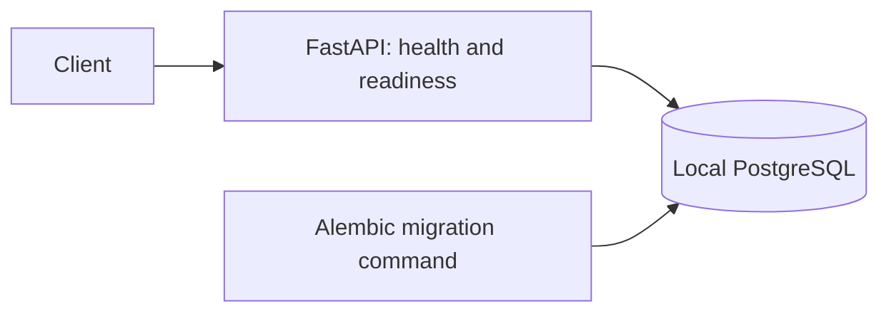
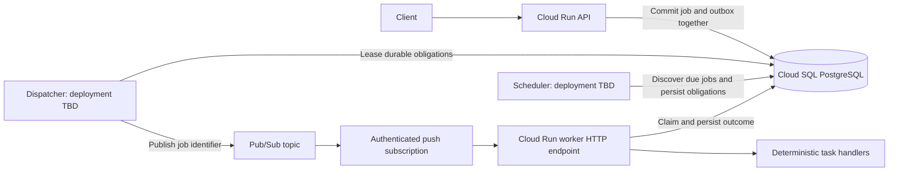

# Distributed Cloud Task Scheduler

## Purpose

Build a small, carefully engineered distributed backend that accepts jobs,
executes them asynchronously, and makes their lifecycle and failure behavior
observable. The repository should support credible discussion of transactions,
concurrency, delivery semantics, recovery, cloud deployment, and performance.
Engineering depth and reproducible evidence matter more than feature count.

This is the stable specification, not an implementation status report. See
[PLAN.md](PLAN.md) for the architecture that currently exists, milestone status,
validation evidence, and next actions. [DECISIONS.md](DECISIONS.md) records
significant design choices and their consequences. Capabilities below describe
the intended completed system unless explicitly identified as a foundation.

## Technical stack

| Area | Choice |
| --- | --- |
| Application | Python 3.12+, FastAPI, Pydantic, asyncio where appropriate |
| Persistence | PostgreSQL, SQLAlchemy 2.x, psycopg 3, Alembic |
| Local development | Docker, Docker Compose, environment-based configuration |
| Cloud target | GCP: Cloud Run, Pub/Sub, Cloud SQL for PostgreSQL, Artifact Registry |
| Infrastructure and delivery | Terraform, GitHub Actions |
| Quality | pytest, Ruff, mypy, one standard verification command |
| Operations | Structured logging, useful metrics, reproducible load/failure experiments |

Load-testing and metrics tools will be chosen when their requirements are clear.
Changes to a major framework, database, transport, cloud, or orchestration
platform require an explicit recorded justification.

## Architecture

Development proceeds locally: first establish the API and database, then prove
job persistence, local execution, and concurrency before introducing messaging
or cloud resources. The initial foundation has this bounded design:



The provisional final cloud design is:



Job persistence and message publication are separate operations. D009 selects a
transactional outbox: commit the job and its dispatch obligation together, publish
outside the transaction, and finalize publication with fenced ownership. A crash
after acceptance can replay publication, so workers must tolerate duplicate IDs.
The cloud dispatcher and scheduler hosting model still requires deployment design.

PostgreSQL is the authoritative store of job state. Messages identify jobs;
workers load authoritative data from the database. Transport adapters must not
make cloud services a prerequisite for domain tests or local execution. Introduce
an interface only when local and cloud implementations need a shared contract.
Keep the API, worker, and eventual scheduler in one project; separate runtime
entry points do not imply independent microservice codebases.

The push worker is a separate HTTP application from the submission API. Its
`POST /pubsub/push` service interface receives wrapped Pub/Sub envelopes containing
only a base64-encoded canonical job UUID. It acknowledges durable terminal outcomes
or retry intent with a replacement outbox obligation,
and requests redelivery while execution or dependency recovery remains outstanding.
D010 defines bounded request execution and the initial acknowledgement policy;
execution retry policy is separate. Production access requires private Cloud Run
service IAM and authenticated Pub/Sub push. Local emulator delivery cannot validate IAM.

## Major components

- **API:** validate submissions, expose job status/listing and manual retry, and
  provide OpenAPI documentation plus health/readiness checks.
- **Job domain and persistence:** explicit lifecycle transitions, constraints,
  transactional claims, idempotency records, and diagnostic attempt history.
- **Execution:** deterministic task handlers and bounded worker concurrency;
  cooperative shutdown and isolated failures where practical.
- **Transport:** durable outbox dispatch, local/test delivery followed by Pub/Sub
  delivery, with explicit acknowledgement and failure behavior.
- **Scheduler:** discover due jobs safely across restarts and multiple instances.
- **Operations:** configuration, container entry points, infrastructure, CI,
  logs/metrics, and reproducible experiments.

## Core capabilities and interfaces

A job has a UUID identifier, task type, validated payload, status, priority,
idempotency information, timestamps, attempt count/limit, error details, and
result metadata where appropriate. Scheduled timestamps use explicit time zones.
The initial lifecycle proposal is:

```text
PENDING -> QUEUED -> RUNNING -> SUCCEEDED
                       |----> RETRY_WAIT -> RUNNING (when due)
                       |----> FAILED (permanent or exhausted)
                       |----> DEAD_LETTERED
```

This is vocabulary, not a complete transition specification. Retry transitions,
claim recovery, and terminal-state definitions must be specified and tested
before implementation. Changes to the lifecycle need a decision entry.
D012 makes application attempts authoritative: each claim and outcome has durable
history; transient failures commit due retry state and a new outbox obligation.
Claims use the database due time, independently of broker deliveries.

The eventual public API includes:

| Operation | Intended purpose |
| --- | --- |
| `POST /jobs` | Submit a validated job, optionally with `Idempotency-Key` |
| `GET /jobs/{id}` | Inspect state and useful outcome/attempt information |
| `GET /jobs/{id}/attempts` | Inspect ordered execution attempt history |
| `GET /jobs` | List jobs with bounded pagination |
| `POST /jobs/{id}/retry` | Retry an eligible failed/dead-lettered job |
| `GET /health` | Process liveness without depending on the database |
| `GET /ready` | Readiness of required dependencies |

Implement interfaces incrementally. Early job submission may only persist data.
Submission identity follows D011: matching validated content under a global key
returns the same job's current state; different content under that key conflicts.
The original submission fingerprint remains independent of execution state.
Use simple tasks such as sleep, calculation, and controlled failure so platform
behavior is measurable. An HTTP task or CPU-bound benchmark may be added only
when its requirements justify it.

## Reliability goals and boundaries

The completed system should make these behaviors explainable and testable:

- Duplicate API submissions with the same valid key and equivalent content
  resolve to the same logical job; conflicting content has a documented outcome.
- Duplicate messages cannot bypass database ownership or overwrite a newer
  attempt's outcome. Claiming and completion use atomic transitions.
- Persisted jobs are not silently stranded by a crash between commit and publish.
- Crashed/stalled ownership can be recovered without letting an obsolete worker
  commit results as the current owner. Database tokens and leases fence completion;
  application retry state and dispatch obligations must commit atomically (D012).
- Transient and permanent failures have distinct handling; retries are bounded,
  observable, and coordinated with broker redelivery to avoid retry storms.
- Exhausted work has an understandable terminal state and appropriate manual
  recovery. Database and broker dead-letter state must be reconcilable.
- Delayed jobs do not execute before their due time; multiple schedulers do not
  lose work. Priority is a documented best-effort policy, not assumed broker order.
- Shutdown, dependency outages, and contention have explicit tested behavior.

Design for at-least-once delivery and possible duplicate execution attempts.
Database ownership and submission idempotency do not prove exactly-once external
side effects. Task-specific side-effect idempotency and the limits of recovery
must be documented. Do not claim guarantees before failure/concurrency tests
demonstrate them. Neither strict global ordering, hard real-time scheduling, nor
unbounded job duration is a project guarantee.

## Boundaries and non-goals

Use Swagger/OpenAPI as the interface. Do not build a React frontend, user account
management, payments, AI features, a service mesh, Kafka, initial Kubernetes, or
a general workflow framework. Application authentication is outside initial
scope; cloud service-to-service access still requires appropriate IAM.

Avoid premature microservices, generic repository frameworks, and abstractions
without a real second use case. Cloud-managed capabilities should replace custom
infrastructure when they fit. Configuration comes from the environment locally
and suitable secret/configuration mechanisms in production; secrets stay outside
source control. GCP provisioning is deferred until local behavior is stable.

## Expected final demonstration

1. Start the local system from documented commands, migrate PostgreSQL, submit
   jobs through OpenAPI/curl, and inspect their terminal results.
2. Demonstrate simultaneous workers, duplicate submissions/messages, delayed
   jobs, bounded retries, exhausted jobs, and manual recovery with clear traces.
3. Interrupt workers and inject dependency/task failures; show recovery and the
   limits of the chosen ownership/side-effect semantics.
4. Deploy the same application model to GCP through documented Terraform and
   delivery workflows, with authenticated Pub/Sub push and observable outcomes.
5. Compare concurrency configurations such as 1, 5, 10, and 20; report throughput,
   p50/p95/p99 latency, failures, resource usage, and the measured bottleneck.
6. Inject approximately 10% transient failures; report initial and eventual
   completion, retries per job, dead-letter rate, and time to eventual success.

Benchmark reports must include environment, workload, configuration, commands,
raw/derived results, and limitations. A C++ comparison is optional and can begin
only after the Python system is complete and benchmarked, using equivalent
CPU-bound work.

## Definition of success

A new engineer can reproduce setup, tests, deployment, and experiments from the
repository. Critical correctness claims have unit, PostgreSQL integration,
concurrency, and end-to-end evidence as appropriate. The standard verification
command passes lint, type checking, and tests. Documentation differentiates
implemented behavior from goals and limitations, and the plan remains current.

The system's state transitions, transaction boundaries, ownership, retry model,
delivery assumptions, recovery gaps, and performance limits are understandable
without its original author. No performance target or cloud reliability claim is
invented in advance of measurements.
